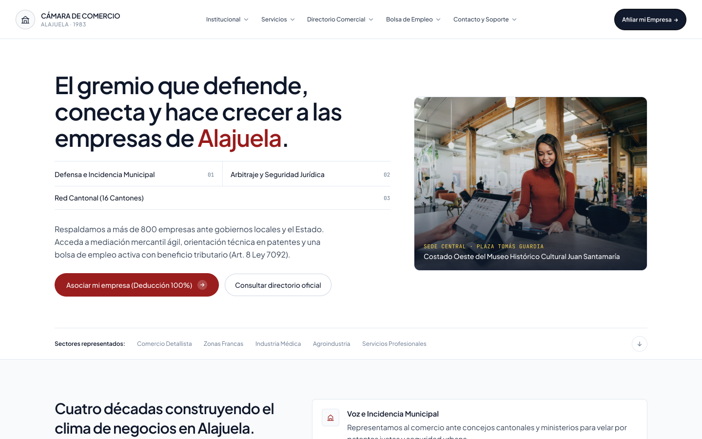
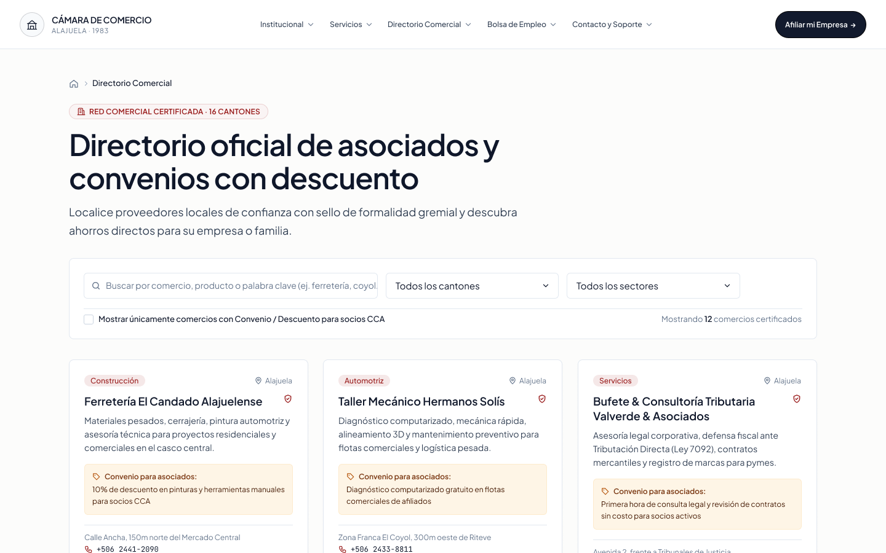
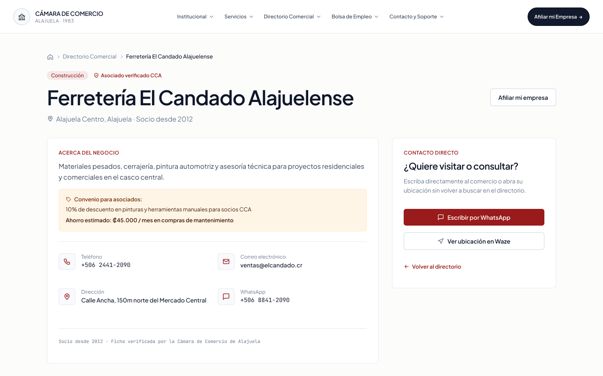
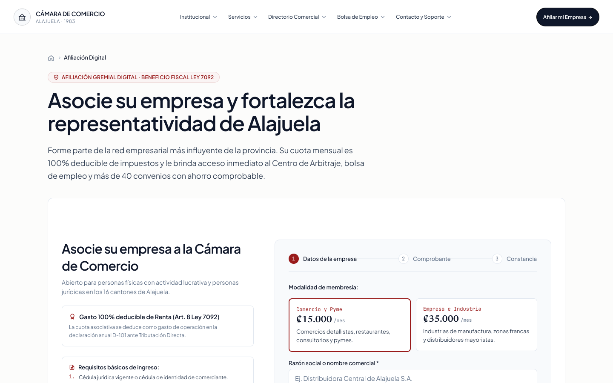
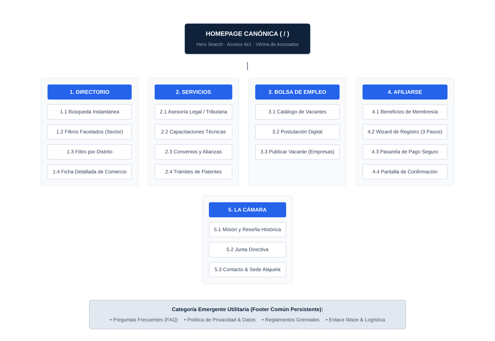
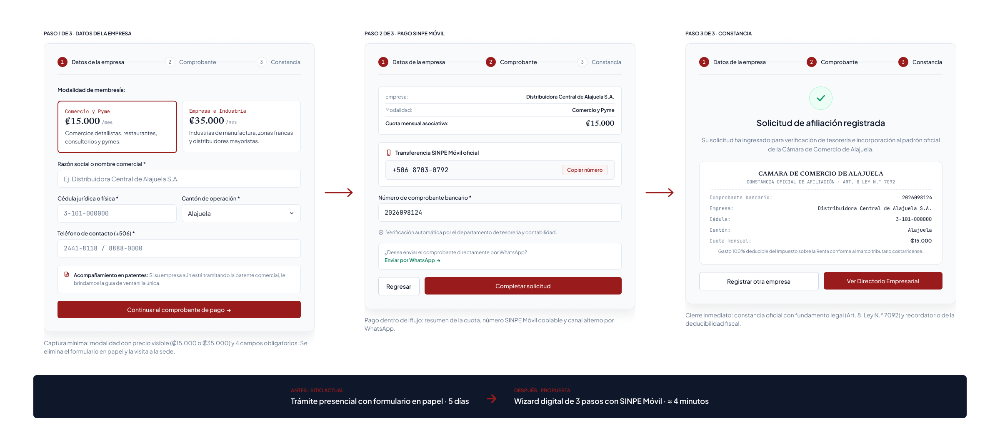

# 7. Composición del Contenido y Wireframes a UI de Alta Fidelidad (Figma)

**Responsable:** Emanuel Soto · Consultor Especialista en Diseño de Interfaz y UI/UX

**Prototipo interactivo:** [Prototipo UX/UI · Cámara de Comercio de Alajuela (Figma)](https://www.figma.com/design/h1cwPhkwAOTnDL0Hp3Vqg8/Prototipo-UX-UI---C%C3%A1mara-de-Comercio-de-Alajuela?node-id=20-297&t=32u9KsQuGYp766H5-0)

---

## 7.1 Enfoque Metodológico de Composición

Rosenfeld et al. (2015) señalan que una arquitectura de información no se agota en el sitemap: cada página debe componerse según el papel que cumple dentro del sistema. Para el portal de la Cámara de Comercio de Alajuela (CCA) se adoptaron tres tipos de páginas, y cada pantalla del prototipo se diseñó a partir del tipo al que pertenece.

**Tabla 7.1**
_Tipos de páginas aplicados a las pantallas del prototipo de la CCA_

| Tipo de página | Propósito | Pantalla del prototipo | Decisiones de composición |
| :-- | :-- | :-- | :-- |
| **Navegación** | Orientar al visitante y distribuirlo hacia las secciones profundas sin cargarlo de texto. | 01 · Inicio | Encabezado único con cinco menús desplegables, titular con la propuesta de valor, índice de tres pilares numerados, dos llamadas a la acción y franja de sectores representados. |
| **Funcional** | Permitir que el usuario introduzca datos, filtre información o complete un trámite. | 03-04 · Directorio y 06-08 · Afiliación | Barra horizontal de filtros (buscador, cantón, sector y convenio) con conteo de resultados, y un wizard de tres pasos con indicador de progreso. |
| **Contenido** | Entregar la información final que el usuario vino a buscar y facilitar la acción siguiente. | 05 · Ficha de comercio | Sello de asociado verificado, convenio destacado, datos de contacto agrupados y acciones directas a WhatsApp y Waze. |

Esta clasificación corrige la patología del sitio actual, donde anuncios de actividades cívicas, trámites gremiales y datos de comercios conviven en la misma página sin jerarquía. Al separar las páginas por función, cada pantalla tiene un único objetivo y una llamada a la acción dominante.

---

## 7.2 Sistema de Diseño Atómico y Tokens

El prototipo se construyó con la metodología de _Atomic Design_ (Frost, 2016), que organiza la interfaz en cinco niveles:

1. **Átomos:** los tokens de color, tipografía, espaciado y radio, definidos como variables de Figma (colecciones `CCA/Primitives`, `CCA/Color`, `CCA/Typography`, `CCA/Spacing` y `CCA/Radius`).
2. **Moléculas:** combinaciones mínimas de átomos con una función concreta, como el botón (`CCA/Button`, con las variantes Primary, Dark y Secondary), los campos y selectores de formulario, la etiqueta de categoría y la caja de convenio.
3. **Organismos:** bloques completos y reutilizables, como el encabezado global (`CCA/HeaderF`, con el submenú abierto y cerrado), la tarjeta de comercio (`CCA/Merchant Card`), la tarjeta de vacante (`CCA/Job Card`) y el panel del wizard de afiliación.
4. **Plantillas:** la disposición de organismos de cada tipo de página: miga de pan, insignia, título y bajada; barra de filtros y rejilla de tarjetas en el Directorio, o bien dos columnas con el wizard en la Afiliación.
5. **Páginas:** las pantallas finales con contenido real de Alajuela, documentadas en la sección 7.4.

Los tokens del prototipo son los mismos que usa el portal implementado: cada variable de Figma corresponde a una variable CSS del frontend (`src/app/globals.css`). Así, diseño y código comparten una sola fuente de verdad visual. La paleta se separa en dos capas: los **primitivos** guardan el valor del color y los **tokens semánticos** guardan su uso (por ejemplo, `color/bg/action` apunta a `brand`). Un cambio de marca se aplica en un solo lugar.

**Tabla 7.2**
_Paleta cromática institucional (valores HSL)_

| Token semántico | Primitivo (CSS) | HEX | HSL | Uso en la interfaz |
| :-- | :-- | :-- | :-- | :-- |
| `color/bg/action` · `color/text/action` | brand (`--color-brand`) | `#991B1B` | hsl(0, 70%, 35%) | Rojo institucional: llamada a la acción principal, enlaces, etiquetas e íconos de marca. |
| — (estado hover) | brand-hover | `#7F1D1D` | hsl(0, 63%, 31%) | Botón principal al pasar el cursor. |
| `color/text/default` · `color/bg/header` | ink (`--color-ink`) | `#0F172A` | hsl(222, 47%, 11%) | Texto principal y botón "Afiliar mi Empresa" del encabezado. |
| `color/bg/blue` | ink-muted | `#334155` | hsl(215, 25%, 27%) | Texto de lectura secundario y menú de navegación. |
| `color/text/muted` | text-muted | `#64748B` | hsl(215, 16%, 47%) | Metadatos, descripciones y textos de ayuda. |
| `color/bg/page` | canvas | `#FCFCFB` | hsl(60, 14%, 99%) | Fondo general de las páginas. |
| `color/bg/surface` | surface | `#FFFFFF` | hsl(0, 0%, 100%) | Blanco puro de tarjetas, formularios y encabezado. |
| `color/bg/accent` | surface-muted | `#F8FAFC` | hsl(210, 40%, 98%) | Paneles atenuados: wizard, secciones alternas e íconos. |
| `color/border/default` | border | `#E2E8F0` | hsl(214, 32%, 91%) | Bordes de 1 px de tarjetas y divisores. |
| `color/border/input` | border-strong | `#CBD5E1` | hsl(213, 27%, 84%) | Bordes de botones secundarios y casillas. |
| `color/text/convenio` | amber (`--color-gold`) | `#B45309` | hsl(26, 90%, 37%) | Ícono y acento de las cajas de convenio con descuento. |
| `color/bg/selected` | brand-subtle | `#FEF2F2` | hsl(0, 86%, 97%) | Fondos suaves de selección. |

**Tabla 7.3**
_Escala tipográfica del prototipo_

| Estilo de texto | Familia | Peso | Tamaño | Uso |
| :-- | :-- | :-- | :-- | :-- |
| `CCA/Display/Hero` · `CCA/Heading/H1` | Plus Jakarta Sans | SemiBold | 48 px (tracking −2,5 %) | Titular de portada y títulos de página. |
| `CCA/Heading/H2` | Plus Jakarta Sans | SemiBold | 36 px | Títulos de sección. |
| `CCA/Heading/H3` | Plus Jakarta Sans | SemiBold | 28 px | Subtítulos de bloque. |
| `CCA/Heading/H4` | Plus Jakarta Sans | SemiBold | 18 px | Nombre del comercio y de la vacante en tarjetas. |
| `CCA/Body/Large` | Plus Jakarta Sans | Regular | 18 px | Bajadas de página. |
| `CCA/Body/Base` | Plus Jakarta Sans | Regular | 16 px | Texto de lectura. |
| `CCA/Body/Small` | Plus Jakarta Sans | Regular | 14 px | Descripciones de tarjetas. |
| `CCA/Label/Base` · `CCA/Label/Small` | Plus Jakarta Sans | SemiBold | 14 y 12 px | Botones, etiquetas y categorías. |
| Cifras de cuota | Newsreader | SemiBold | 22 px | Precio de las modalidades y constancia. |
| Metadatos | JetBrains Mono | Regular | 11-12 px | Jornada, fecha, "Socio desde", teléfonos y numeración. |

Una sola familia sans-serif, Plus Jakarta Sans, cubre títulos e interfaz y da un tono sobrio e institucional. La serif Newsreader se reserva para las cifras de dinero, y la monoespaciada marca los datos técnicos (teléfonos, códigos y fechas), que así se distinguen del texto de lectura. El cuerpo de lectura parte de 16 px.

**Tabla 7.4**
_Escala de espaciado y radios_

| Token | Valor | Token | Valor |
| :-- | :-- | :-- | :-- |
| `space/1` | 4 px | `space/8` | 32 px |
| `space/2` | 8 px | `space/10` | 40 px |
| `space/3` | 12 px | `space/12` | 48 px |
| `space/4` | 16 px | `space/16` | 64 px |
| `space/5` | 20 px | `space/18` | 72 px |
| `space/6` | 24 px | `radius/sm` · `base` · `lg` · `xl` · `full` | 4 · 6 · 8 · 12 px · píldora |

El espaciado sigue la rejilla de Tailwind CSS que usa el frontend: base de 4 px con pasos principales múltiplos de 8 px. Los radios replican los del código: 6 px en botones, 8 px en tarjetas, 12 px en paneles y la imagen del hero, y forma de píldora en las llamadas a la acción de la portada.

---

## 7.3 Fisiología de Auto Layout y Adaptabilidad

Auto Layout es la traducción en Figma del modelo CSS Flexbox. Un contenedor con Auto Layout ya no posiciona a sus hijos por coordenadas, sino por reglas, igual que un contenedor `display: flex`:

**Tabla 7.5**
_Correspondencia entre Auto Layout de Figma y CSS Flexbox_

| Propiedad en Figma | Equivalente CSS | Efecto en el prototipo |
| :-- | :-- | :-- |
| Dirección horizontal / vertical | `flex-direction: row / column` | Fila del botón con su ícono; pila vertical de la tarjeta de comercio. |
| _Gap_ (espacio entre elementos) | `gap` | Separación constante entre los campos del wizard. |
| _Padding_ | `padding` | Margen interno de 24 px de las tarjetas (`p-6`) y de 32 px del panel del wizard (`p-8`). |
| _Hug contents_ | `width: fit-content` | El botón crece o se reduce según la longitud de su etiqueta. |
| _Fill container_ | `flex: 1` / `width: 100%` | Campos y botones ocupan el ancho disponible del formulario. |
| Alineación (_space between_, centro) | `justify-content` / `align-items` | Salario a la izquierda y botón "Postularme Ahora" a la derecha en el pie de la vacante. |

En el prototipo, Auto Layout se aplica a los componentes que cambian de contenido o de ancho: el botón `CCA/Button`, las tarjetas `CCA/Merchant Card` y `CCA/Job Card`, y el panel completo del wizard. Gracias a ello, al cambiar el nombre de un comercio o la etiqueta de un botón, el componente se reacomoda solo y conserva los márgenes definidos por los tokens. No hay que redibujarlo.

Para la adaptabilidad, este comportamiento es el mismo que sigue la implementación web. Un contenedor configurado con _fill container_ en Figma corresponde a un elemento fluido en CSS. Así, el paso de la rejilla de escritorio (tres columnas de tarjetas a 1440 px) a una sola columna en móvil se logra apilando los mismos componentes, sin rediseñarlos. Esto es relevante porque el 83 % de los comerciantes accede desde el móvil: los campos de formulario mantienen una altura de al menos 42 px y el texto base de 16 px en cualquier ancho.

---

## 7.4 Catálogo de Pantallas Finales de Alta Fidelidad

Las cuatro pantallas siguientes se exportaron directamente del prototipo de Figma, alineado con el portal implementado. Su composición se analiza desde las leyes de la Gestalt (Wagemans et al., 2012), los patrones de lectura en pantalla (Nielsen y Pernice, 2010) y las necesidades de los dos buyer personas del proyecto:

- **Doña Rosa:** comerciante tradicional, dueña de una soda. Necesita botones grandes, tipografía legible y WhatsApp a un clic.
- **Esteban:** joven emprendedor de comercio electrónico. Escanea en F y busca convenios rápidamente.

### Figura 7.1. Pantalla de inicio

_Nota._ Pantalla 01 · Inicio del prototipo de alta fidelidad. Elaboración propia en Figma.

- **Jerarquía y escaneo:** el titular, el índice de tres pilares y los dos botones se alinean en una sola columna a la izquierda, siguiendo la lectura en F. Un visitante que solo escanea (Esteban) entiende en segundos qué hace la Cámara: defensa municipal, arbitraje y red cantonal.
- **Semejanza y contraste:** la palabra "Alajuela" y el botón "Asociar mi empresa (Deducción 100%)" comparten el rojo institucional, y son los únicos elementos rojos de la pantalla. La acción principal destaca sin competir con el resto.
- **Ergonomía (Doña Rosa):** el menú se reduce a cinco categorías validadas en el estudio de card sorting. El botón "Afiliar mi Empresa" se mantiene fijo en la esquina superior derecha, en todas las pantallas.

### Figura 7.2. Directorio comercial con filtros facetados

_Nota._ Pantalla 03 · Directorio del prototipo de alta fidelidad. Elaboración propia en Figma.

- **Región común:** todos los controles de búsqueda viven en una sola tarjeta horizontal: buscador, cantón, sector y la casilla de convenio. Los resultados quedan debajo, en otra zona, y el usuario distingue sin esfuerzo dónde controla la búsqueda y dónde ve el resultado.
- **Proximidad y semejanza:** cada tarjeta agrupa categoría, cantón, nombre con sello de verificación, descripción, convenio, dirección y teléfono. Todas comparten la misma estructura, así que el ojo compara comercios sin reaprender la tarjeta.
- **Ergonomía:** el conteo "Mostrando 12 comercios certificados" confirma el efecto de cada filtro. La caja ámbar del convenio hace visible el beneficio económico de la red sin abrir la ficha.

### Figura 7.3. Ficha técnica de comercio afiliado

_Nota._ Pantalla 05 · Ficha de comercio del prototipo de alta fidelidad. Elaboración propia en Figma.

- **Página de contenido:** la miga de pan (Directorio Comercial › Ferretería El Candado Alajuelense) ubica al usuario dentro de la jerarquía, y la etiqueta "Asociado verificado CCA" funciona como señal de confianza.
- **Proximidad:** teléfono, correo, dirección y WhatsApp se agrupan en una rejilla de datos con íconos, separada de la descripción y del convenio con su ahorro estimado.
- **Ergonomía (Doña Rosa):** "Escribir por WhatsApp" y "Ver ubicación en Waze" son botones de ancho completo en la columna derecha. El contacto pasa de 4 clics sin número visible en el sitio actual a 1 clic.

### Figura 7.4. Wizard de afiliación digital

_Nota._ Pantalla 06 · Afiliación · Paso 1 del prototipo de alta fidelidad. Elaboración propia en Figma.

- **Dos columnas con roles distintos:** a la izquierda, los argumentos para afiliarse (deducibilidad fiscal, requisitos y beneficios); a la derecha, el formulario dentro de un panel atenuado. El usuario decide y actúa en la misma página.
- **Indicador de progreso:** los tres pasos numerados (Datos de la empresa → Comprobante → Constancia) le dicen al usuario cuánto falta, lo que reduce el abandono del formulario.
- **Ergonomía:** las modalidades son tarjetas completas clicables con el precio visible. La opción elegida se resalta con borde rojo, y el botón "Continuar al comprobante de pago" ocupa todo el ancho al final del formulario.

### Navegación sin pantallas huérfanas

Las pantallas están conectadas en un flujo de prototipo de Figma ("Flow 1") con 54 interacciones definidas:

- **Desde la portada:** "Consultar directorio oficial" lleva al Directorio. Ahí, el filtro de sector muestra los resultados de Construcción y la primera tarjeta abre la Ficha de la Ferretería El Candado.
- **Afiliación:** "Afiliar mi Empresa" (encabezado), "Asociar mi empresa" (portada) y "Afiliar mi empresa" (ficha) abren el wizard. El wizard avanza del Paso 1 al Paso 2 y a la Constancia, desde donde se puede volver al Directorio o registrar otra empresa.
- **Encabezado:** "Servicios" despliega el submenú y "Bolsa de Empleo" abre la pantalla de vacantes.

Ninguna pantalla del flujo queda sin una salida.

---

## 7.5 Flujo Transaccional y Checkout

La afiliación es la transacción principal del portal, porque convierte a un visitante en asociado de la Cámara. Hoy es un trámite presencial con formulario en papel. La propuesta lo transforma en un checkout digital de tres pasos que se completa sin salir del sitio.

### Figura 7.5. Sitemap macro del nuevo portal

_Nota._ Arquitectura taxonómica del nuevo portal: página de inicio canónica, cinco ramas maestras y pie de página utilitario. Elaboración propia a partir del modelado en FlowMapp.

El sitemap ubica el checkout dentro de la rama **4. Afiliarse** (4.1 Beneficios de membresía → 4.2 Wizard de registro → 4.3 Pasarela de pago → 4.4 Confirmación). Desde la portada, la afiliación queda a un clic por medio del botón "Afiliar mi Empresa", presente en todas las pantallas.

### Figura 7.6. Flujo de checkout de afiliación

_Nota._ Los tres pasos del wizard de afiliación con pago por SINPE Móvil, tal como aparecen en las pantallas 06 a 08 del prototipo. Elaboración propia en Figma.

Cada paso elimina una fuente de fricción específica del proceso actual:

**Tabla 7.6**
_Reducción de fricción por paso del checkout_

| Paso | Qué hace el usuario | Fricción que elimina |
| :-- | :-- | :-- |
| **1. Datos de la empresa** | Elige la modalidad (Comercio y Pyme, ₡15.000/mes, o Empresa e Industria, ₡35.000/mes) y completa 4 campos obligatorios. | La visita a la sede y el formulario en papel. El precio se ve antes de comprometerse. |
| **2. Comprobante (SINPE Móvil)** | Revisa el resumen de su cuota, transfiere al número oficial de la Cámara e ingresa el número de comprobante, o lo envía por WhatsApp. | La necesidad de pagar en ventanilla. El canal por WhatsApp da asistencia a quien no se siente seguro con el formulario (Doña Rosa). |
| **3. Constancia** | Recibe una constancia de afiliación con sus datos, el fundamento legal (Art. 8, Ley N.° 7092) y el recordatorio de que la cuota es deducible del impuesto sobre la renta. | La espera para saber si la solicitud fue recibida. |

El flujo se ajusta a las leyes de la Gestalt en dos puntos:

- **Continuidad:** el indicador de progreso de tres círculos se repite en cada paso y se completa a medida que el usuario avanza, como una misma secuencia.
- **Región común:** la información de pago (cuota, número SINPE y comprobante) se agrupa en bloques blancos delimitados dentro del panel.

Las acciones mantienen siempre la misma posición: el botón principal rojo a la derecha y "Regresar" a la izquierda, de modo que el usuario no busca el siguiente paso. Con este flujo, la afiliación pasa de un trámite presencial que hoy toma alrededor de 5 días a un proceso digital que se estima en unos 4 minutos.

---

## Referencias del capítulo

Frost, B. (2016). _Atomic design_. Brad Frost. https://atomicdesign.bradfrost.com/

Nielsen, J., & Pernice, K. (2010). _Eyetracking web usability_. New Riders.

Rosenfeld, L., Morville, P., & Arango, J. (2015). _Information architecture: For the web and beyond_ (4th ed.). O'Reilly Media.

Wagemans, J., Elder, J. H., Kubovy, M., Palmer, S. E., Peterson, M. A., Singh, M., & von der Heydt, R. (2012). A century of Gestalt psychology in visual perception: I. Perceptual grouping and figure–ground organization. _Psychological Bulletin, 138_(6), 1172–1217. https://doi.org/10.1037/a0029333
