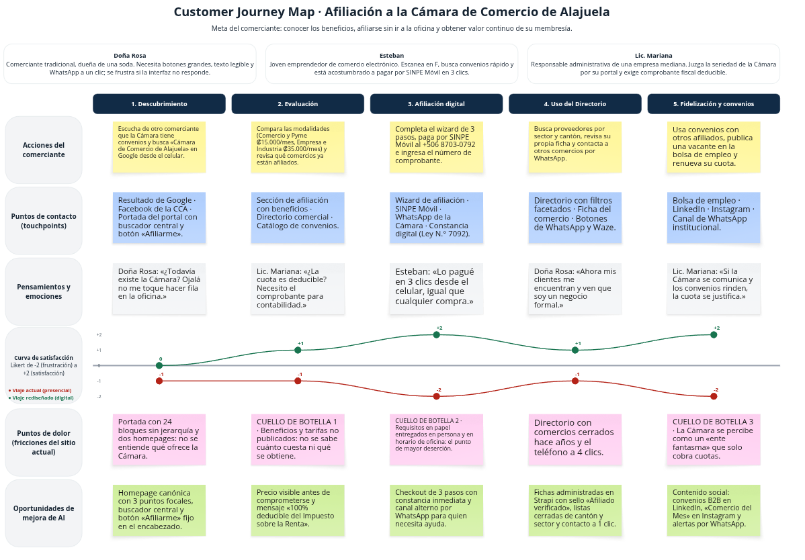

# 11. Customer Journey Map y Contenido Social

**Responsable:** Emanuel Soto · Consultor Especialista en Experiencia del Usuario y Estrategia Social

---

## 11.1 Metodología de Mapeo Empático

Un _Customer Journey Map_ (CJM) representa, en una sola vista, la experiencia completa de una persona mientras intenta lograr un objetivo con una organización: qué hace, por dónde pasa, qué piensa y siente, y dónde se traba. Kalbach (2020) lo describe como una herramienta de alineación: permite que todos los involucrados vean la experiencia desde el lado del usuario y no desde el organigrama interno. En Arquitectura de Información (AI), este enfoque complementa al sitemap. El sitemap muestra cómo está organizado el contenido, y el CJM muestra en qué momento del viaje cada contenido se vuelve necesario (Rosenfeld et al., 2015).

Para la Cámara de Comercio de Alajuela (CCA), el mapa se construyó en Miro con una matriz de **5 etapas temporales × 5 carriles de análisis** (25 cuadrantes):

- **Etapas (columnas):** 1) Descubrimiento, 2) Evaluación, 3) Afiliación digital, 4) Uso del Directorio y 5) Fidelización y convenios.
- **Carriles (filas):** Acciones del comerciante, Puntos de contacto, Pensamientos y emociones (con curva de satisfacción), Puntos de dolor y Oportunidades de mejora de AI.

El mapa integra a los tres buyer personas del proyecto:

- **Doña Rosa:** comerciante tradicional, dueña de una soda. Necesita botones grandes, texto legible y WhatsApp a un clic.
- **Esteban:** joven emprendedor de comercio electrónico. Busca convenios rápido y está acostumbrado a pagar por SINPE Móvil.
- **Lic. Mariana:** responsable administrativa de una empresa mediana. Juzga la seriedad de la Cámara por su portal y exige comprobante fiscal deducible.

Cada pensamiento del mapa se atribuye a la persona para la que ese momento es más crítico.

El tablero se generó en Miro de forma automática a partir de la matriz estructurada del proyecto, por medio de la API REST de Miro (`tools/08_miro_cjm/`). Así, los 25 cuadrantes del tablero coinciden exactamente con el contenido documentado en este capítulo.

---

## 11.2 Análisis Dimensional de las 5 Etapas

**Tabla 11.1**
_Matriz del Customer Journey Map: 5 etapas × 5 carriles_

| Carril | 1. Descubrimiento | 2. Evaluación | 3. Afiliación digital | 4. Uso del Directorio | 5. Fidelización y convenios |
| :-- | :-- | :-- | :-- | :-- | :-- |
| **Acciones** | Escucha de otro comerciante que la Cámara tiene convenios y la busca en Google desde el celular. | Compara las modalidades (Comercio y Pyme ₡15.000/mes; Empresa e Industria ₡35.000/mes) y revisa qué comercios ya están afiliados. | Completa el wizard de 3 pasos, paga por SINPE Móvil al +506 8703-0792 e ingresa el número de comprobante. | Busca proveedores por sector y cantón, revisa su propia ficha y contacta a otros comercios por WhatsApp. | Usa convenios con otros afiliados, publica una vacante en la bolsa de empleo y renueva su cuota. |
| **Puntos de contacto** | Resultado de Google · Facebook de la CCA · Portada con buscador central y botón «Afiliarme». | Sección de afiliación con beneficios · Directorio comercial · Catálogo de convenios. | Wizard de afiliación · SINPE Móvil · WhatsApp de la Cámara · Constancia digital (Ley N.° 7092). | Directorio con filtros facetados · Ficha del comercio · Botones de WhatsApp y Waze. | Bolsa de empleo · LinkedIn · Instagram · Canal de WhatsApp institucional. |
| **Pensamientos** | Doña Rosa: «¿Todavía existe la Cámara? Ojalá no me toque hacer fila en la oficina.» | Lic. Mariana: «¿La cuota es deducible? Necesito el comprobante para contabilidad.» | Esteban: «Lo pagué en 3 clics desde el celular, igual que cualquier compra.» | Doña Rosa: «Ahora mis clientes me encuentran y ven que soy un negocio formal.» | Lic. Mariana: «Si la Cámara se comunica y los convenios rinden, la cuota se justifica.» |
| **Puntos de dolor** | Portada con 24 bloques sin jerarquía y dos homepages: no se entiende qué ofrece la Cámara. | **Cuello de botella 1:** beneficios y tarifas no publicados. | **Cuello de botella 2:** requisitos en papel, entregados en persona y en horario de oficina. | Directorio con comercios cerrados hace años y el teléfono a 4 clics. | **Cuello de botella 3:** la Cámara se percibe como un «ente fantasma» que solo cobra cuotas. |
| **Oportunidades de AI** | Homepage canónica con 3 puntos focales, buscador central y botón «Afiliarme» fijo. | Precio visible antes de comprometerse y mensaje «100% deducible del Impuesto sobre la Renta». | Checkout de 3 pasos con constancia inmediata y canal alterno por WhatsApp. | Fichas administradas en Strapi con sello «Afiliado verificado», listas cerradas de cantón y sector, y contacto a 1 clic. | Contenido social: convenios B2B en LinkedIn, «Comercio del Mes» en Instagram y alertas por WhatsApp. |

**1. Descubrimiento.** El viaje empieza fuera del sitio, con una recomendación de boca en boca y una búsqueda en Google desde el celular. La primera impresión depende de la portada. Hoy, con 24 bloques y dos homepages compitiendo, Doña Rosa no logra entender si la Cámara sigue activa ni qué ofrece. La respuesta de AI es una portada canónica con tres puntos focales y el botón «Afiliarme» siempre visible.

**2. Evaluación.** El comerciante decide si la membresía vale lo que cuesta. Para Lic. Mariana, la pregunta clave es fiscal: necesita saber que la cuota es deducible. Por eso la propuesta muestra el precio de cada modalidad y el mensaje de deducibilidad antes de iniciar el trámite.

**3. Afiliación digital.** Es el momento de compromiso. En el proceso actual el viaje se rompe aquí, porque el comerciante tiene que reunir requisitos en papel y presentarse en la oficina. El checkout digital de tres pasos permite que Esteban pague por SINPE Móvil desde el celular. Doña Rosa, si duda, puede enviar el comprobante por WhatsApp con ayuda del personal.

**4. Uso del Directorio.** Ya afiliado, el comerciante comprueba el valor de estar en la Cámara: aparece con el sello de afiliado verificado y sus clientes lo contactan en un clic. Para que este valor se sostenga, los datos se administran en Strapi (Capítulo 10) y no quedan congelados como en el directorio actual.

**5. Fidelización y convenios.** La renovación depende de que el afiliado perciba valor continuo. Entre un pago y otro, la Cámara necesita estar presente: convenios útiles, la bolsa de empleo y comunicación activa en redes sociales (sección 11.5).

---

## 11.3 Diagnóstico de Fricciones y Curva Emocional

El mapa confirma los tres cuellos de botella del sitio actual y muestra cómo la Arquitectura de Información los resuelve:

**Tabla 11.2**
_Cuellos de botella del viaje actual y su resolución desde la AI_

| Cuello de botella | Etapa | Efecto en el comerciante | Resolución desde la AI |
| :-- | :-- | :-- | :-- |
| **1. Beneficios y tarifas no publicados** | Evaluación | No sabe cuánto cuesta ni qué obtiene, así que posterga la decisión. | Contenido de afiliación con modalidades y precios visibles, beneficios explícitos y el mensaje de deducibilidad fiscal. |
| **2. Afiliación presencial con requisitos en papel** | Afiliación digital | Debe ir a la oficina en horario laboral; muchos abandonan antes de afiliarse. | Checkout digital de 3 pasos con SINPE Móvil, constancia inmediata y canal de asistencia por WhatsApp. |
| **3. La Cámara como «ente fantasma»** | Fidelización | Solo tiene contacto con la Cámara al pagar; no percibe valor y no renueva. | Directorio vivo administrado en Strapi y estrategia de contenido social omnicanal. |

**Tabla 11.3**
_Curva de satisfacción por etapa (escala Likert de −2 a +2)_

| Etapa | Viaje actual (presencial) | Viaje rediseñado (digital) |
| :-- | :-: | :-: |
| 1. Descubrimiento | −1 | 0 |
| 2. Evaluación | −1 | +1 |
| 3. Afiliación digital | **−2** | **+2** |
| 4. Uso del Directorio | −1 | +1 |
| 5. Fidelización y convenios | −2 | +2 |

_Nota._ Valoración cualitativa del equipo consultor a partir del diagnóstico del sitio y de los buyer personas. No es una medición con usuarios.

**Contraste entre los dos viajes.** En el viaje actual, la curva nunca sale del terreno negativo y toca fondo dos veces. La primera caída ocurre en la **afiliación**: es el punto de mayor deserción, porque el comerciante abandona antes de convertirse en socio. La segunda ocurre en la **fidelización**: quien sí se afilió deja de renovar porque no percibe valor. En el viaje rediseñado, la afiliación pasa del punto más bajo (−2) al más alto (+2). Ese es el mayor cambio de todo el mapa, y muestra que la arquitectura web convierte la principal fricción de la Cámara en su principal oportunidad de captar nuevos afiliados.

---

## 11.4 Gráfico del Customer Journey Map en Miro

### Figura 11.1. Customer Journey Map de la afiliación a la Cámara de Comercio de Alajuela

_Nota._ Tablero de Miro con 5 etapas, 5 carriles, los tres buyer personas y la curva de satisfacción del viaje actual (rojo) frente al rediseñado (verde). El contenido completo de los 25 cuadrantes se transcribe en la Tabla 11.1. Elaboración propia en Miro.

---

## 11.5 Estrategia de Contenido Social Omnicanal

Hoy la Cámara tiene un solo canal digital, el sitio web estático, y fuera del cobro de cuotas casi no se comunica con sus afiliados. La estrategia propone tres canales sincronizados con el portal. Cada uno cumple una función distinta y apunta a una persona distinta.

**Tabla 11.4**
_Matriz de contenido social por canal_

| Canal | Persona y público | Contenido | Frecuencia propuesta | Objetivo en el viaje |
| :-- | :-- | :-- | :-- | :-- |
| **LinkedIn** | Lic. Mariana; empresas medianas, industrias y zonas francas. | Convenios corporativos B2B, alianzas con bancos y aseguradoras, capacitaciones y vacantes de la bolsa de empleo. | Semanal | Evaluación y fidelización: demostrar la seriedad institucional y el retorno de la membresía. |
| **Instagram** | Doña Rosa, Esteban y los clientes de Alajuela. | Campaña «Comercio del Mes»: un afiliado verificado destacado con foto, historia y enlace a su ficha del directorio. | Mensual (un comercio por mes), con publicaciones de apoyo semanales | Descubrimiento y uso del directorio: dar visibilidad al comerciante y atraer nuevos afiliados. |
| **Canal de WhatsApp institucional** | Todos los afiliados, en especial Doña Rosa. | Alertas transaccionales: confirmación de afiliación, recordatorio de pago antes del vencimiento, nuevos convenios y vacantes. | Según el evento | Afiliación y fidelización: acompañar al afiliado en los momentos críticos y evitar que olvide renovar. |

**Sincronización con el portal.** Los tres canales enlazan siempre a una página del portal: la ficha del comercio destacado, el catálogo de convenios o la vacante publicada. Ninguno funciona como un sitio paralelo. El contenido nace en Strapi (Capítulo 10) y las redes lo difunden. Así, la Cámara mantiene una sola fuente de información y cada publicación lleva al visitante de vuelta al viaje de afiliación.

---

## Referencias del capítulo

Kalbach, J. (2020). _Mapping experiences: A complete guide to customer alignment through journeys, blueprints, and diagrams_ (2nd ed.). O'Reilly Media.

Rosenfeld, L., Morville, P., & Arango, J. (2015). _Information architecture: For the web and beyond_ (4th ed.). O'Reilly Media.
