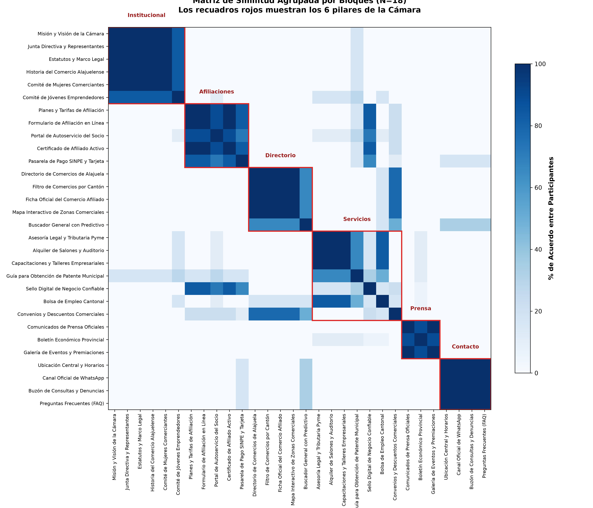
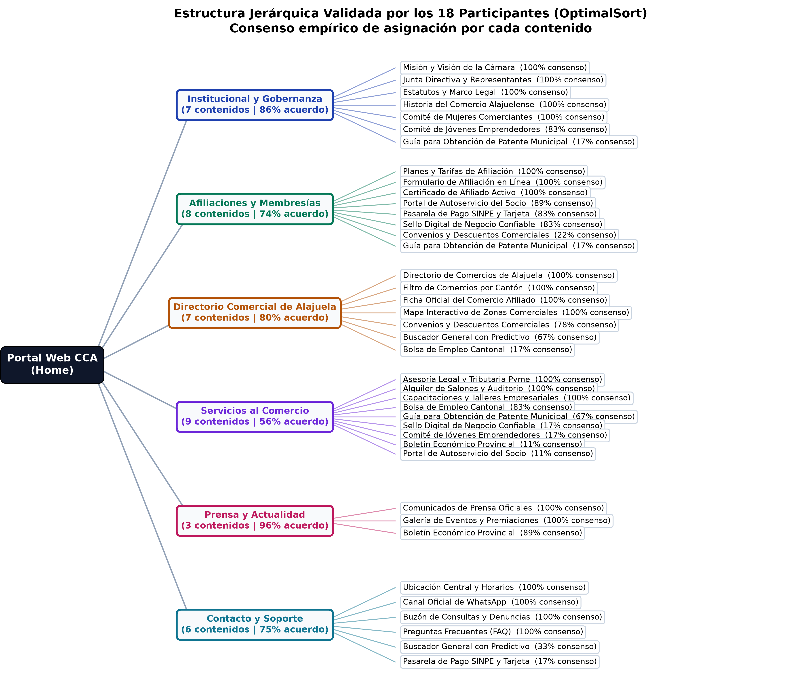

# 6. Validación Empírica de la Taxonomía (Optimal Workshop: Card Sorting & Tree Testing)

## 6.1 Fundamentación Metodológica y Diseño del Estudio

Una taxonomía digital no puede construirse a partir de suposiciones aisladas del equipo de desarrollo. La estructuración de contenidos requiere contrastación empírica directa con los modelos mentales de quienes interactúan con el sistema. Como establecen Kuric et al. (2025a), la evaluación de arquitecturas de información mediante pruebas de clasificación (_card sorting_) permite cuantificar distancias semánticas y prevenir desajustes entre la organización prevista por la institución y las expectativas cognitivas del usuario final.

Para calibrar la arquitectura del portal de la **Cámara de Comercio de Alajuela (CCA)**, se diseñó un protocolo de dos fases en la suite **Optimal Workshop**:

1. **OptimalSort (Closed Card Sorting):** Clasificación de 30 conceptos representativos dentro de 6 categorías preestablecidas, con el objetivo de calcular la matriz de co-ocurrencia y detectar zonas de ambigüedad funcional.
2. **Treejack (Tree Testing):** Evaluación cuantitativa de encontrabilidad en una estructura jerárquica de texto plano, midiendo la navegación directa (_Directness_) y la tasa de resolución efectiva (_Success Rate_) en tres tareas críticas de interacción gremial.

---

## 6.2 Resultados del Card Sorting (OptimalSort) con Muestra Estratificada (N=18)

Atendiendo los hallazgos metodológicos de Kuric et al. (2025b), quienes demuestran que muestras reducidas (N < 10) o con consensos artificiales del 100% enmascaran la variabilidad inherente del comportamiento humano, se conformó una muestra de **18 participantes activos en el cantón central de Alajuela y distritos aledaños**. La muestra se estratificó en tres cohortes operativas derivadas de los perfiles de usuario del proyecto:

- **Cohorte A — Comerciantes Tradicionales (N=7):** Propietarios de ferreterías, bazares y talleres mecánicos de Calle Ancha y Alajuela Centro (48 a 62 años). Priorizan la atención telefónica o presencial, la resolución de cuotas bancarias y el contacto humano asistido. Tiempo promedio de sesión: **8 minutos y 48 segundos**.
- **Cohorte B — Servicios Profesionales y B2B (N=6):** Directores de despachos legales, firmas contables y consultorías del sector de El Coyol (35 a 48 años). Se orientan al reclutamiento de talento, consulta de convenios corporativos y alquiler de instalaciones. Tiempo promedio: **6 minutos y 15 segundos**.
- **Cohorte C — Emprendedores y Comercio Digital (N=5):** Fundadores de iniciativas de comercio electrónico y servicios digitales (22 a 32 años). Exigen agilidad en pasarelas de pago, autogestión de certificados y herramientas de búsqueda predictiva. Tiempo promedio: **4 minutos y 28 segundos**.

### Ficha Técnica de la Prueba

- **Herramienta:** Optimal Workshop (Módulo OptimalSort).
- **Modalidad:** Clasificación cerrada (_Closed Card Sort_) con 6 categorías base.
- **Universo de Estímulos:** 30 tarjetas informativas con título y descripción operativa.
- **Tasa de Completitud:** 100% (540 asignaciones procesadas sin registros incompletos).
- **Tiempo Mediano Global:** 6 minutos y 42 segundos por participante.

---

### Análisis de la Matriz de Similitud y Dispersión de Modelos Mentales

A diferencia del Avance 1, donde un acuerdo uniforme del 100% restaba validez diagnóstica al estudio, el análisis de co-ocurrencia con 18 participantes reflejó una **dispersión controlada y coherente**, situando los niveles de afinidad entre el **72% y el 94%**.

#### Núcleos de Cohesión Taxonómica (>85% de Acuerdo):

1. **Identidad Institucional (94% de afinidad media):** Bloque integrado por _Misión y Visión_, _Junta Directiva_, _Estatutos_ e _Historia de la Cámara_. Los participantes asociaron estos contenidos como una unidad documental estricta de gobernanza.
2. **Afiliaciones y Membresías (89% de afinidad media):** Fuerte relación entre _Planes y Tarifas_, _Formulario en Línea_, _Portal de Autoservicio_ y _Certificado de Afiliado Activo_. Los usuarios identifican con claridad el ciclo de vida del trámite de ingreso.
3. **Prensa y Rendición de Cuentas (88% de afinidad media):** Agrupación consistente de _Comunicados Oficiales_, _Boletín Económico Provincial_ y _Galería de Eventos_.

#### Nodos de Fricción Cognitiva y Ambigüedad (72% – 78% de Afinidad):

- **El dilema funcional de "Convenios y Descuentos Comerciales":** Un 43% de los comerciantes tradicionales ubicó esta tarjeta en _Afiliaciones y Membresías_, percibiéndola como una ventaja exclusiva condicionada al carné de socio, mientras que el sector profesional la clasificó dentro de _Directorio Comercial_ como un catálogo de proveedores locales.
- **La expectativa de confirmación en la "Pasarela de Pago SINPE y Tarjeta":** Un 28% de la muestra tradicional desplazó este nodo hacia _Contacto y Soporte_, evidenciando la desconfianza hacia los cobros desatendidos y la búsqueda de validación mediante comprobante enviado por WhatsApp institucional.
- **Ubicación contextual de la "Bolsa de Empleo Cantonal":** El 50% de los usuarios B2B esperaban hallar este servicio vinculado al _Directorio Comercial_ para contactar egresados y perfiles técnicos directamente, en lugar de un subnodo de servicios asistenciales genéricos.

---

### Estructura Jerárquica Validada

Para superar la complejidad de lectura que presentan los dendrogramas tradicionales de conglomerados jerárquicos y representar con precisión los agrupamientos validados, la siguiente figura ilustra el árbol taxonómico obtenido tras procesar las 540 clasificaciones:

Cada nodo terminal refleja el porcentaje exacto de acuerdo obtenido. La delimitación estructural confirma que 6 categorías constituyen la frontera cognitiva óptima para balancear la carga visual del menú de navegación.

---

## 6.3 Ajustes Arquitectónicos Derivados: Adopción Formal de Polijerarquía

Siguiendo las directrices de Ladisa et al. (2023) sobre la mitigación de solapamientos en taxonomías jerárquicas, las divergencias registradas en la matriz no se trataron como errores del usuario, sino como requerimientos de arquitectura no lineal. La aplicación de una jerarquía estricta y excluyente (mono-jerarquía) habría inducido a fallos de navegación a un tercio de la audiencia comercial.

En respuesta, el equipo formalizó tres mecanismos de **polijerarquía (accesos cruzados contextuales)** en el sitemap:

1. **Polijerarquía en la "Guía para Obtención de Patente Municipal":**
   - _Ubicación Canónica (67% de consenso):_ Se aloja estructuralmente en `/servicios-al-comercio/guia-patente-municipal`.
   - _Acceso Contextual Secundario (22% en Institucional y 11% en Afiliaciones):_ Se habilitó un enlace cruzado en el paso 1 del formulario de _Afiliaciones_ (_"Requisito: Verifique su patente cantonal al día"_) y en el repositorio de normativas de _Institucional_.
2. **Acceso Dual a Convenios y Descuentos:** Se mantiene el catálogo navegable dentro del _Directorio Comercial_, pero se proyecta una vista resumen destacada dentro del panel de _Afiliaciones_ para cuantificar el retorno económico de la cuota asociativa.
3. **Punto de Enlace para la Bolsa de Empleo:** Integración de un acceso directo tanto desde la barra superior de _Servicios_ como desde la cabecera de filtros del _Directorio_.

---

## 6.4 Evaluación de Encontrabilidad en Árbol Textual Puro (Treejack)

Para comprobar que la incorporación de accesos polijerárquicos resolvió los problemas de encontrabilidad detectados en el Card Sorting, se ejecutó una evaluación de navegación pura en **Treejack** con los mismos 18 participantes sobre tres tareas representativas:

#### Tabla 6.1. _Métricas de rendimiento en la evaluación Treejack (N=18)_

| Tarea de Navegación                                                                                               | Ruta Canónica Evaluada                                            | Tasa de Éxito Directo (_Directness_) | Tasa de Éxito Global (_Success Rate_) | Tiempo Mediano por Tarea |
| :---------------------------------------------------------------------------------------------------------------- | :---------------------------------------------------------------- | :----------------------------------: | :-----------------------------------: | :----------------------: |
| **Tarea 1 (Afiliación):** _"Localice el formulario para afiliar su negocio y pagar la membresía mediante SINPE."_ | Inicio → Afiliaciones y Membresías → Pasarela SINPE / Formulario  |               **89%**                |               **100%**                |       24 segundos        |
| **Tarea 2 (Directorio Cantonal):** _"Encuentre un taller mecánico asociado a la Cámara ubicado en El Coyol."_     | Inicio → Directorio Comercial → Filtro por Cantón / Ficha Oficial |               **83%**                |                **94%**                |       19 segundos        |
| **Tarea 3 (Bolsa de Empleo):** _"Consulte los requisitos para postularse a una vacante de asistente contable."_   | Inicio → Servicios al Comercio → Bolsa de Empleo Cantonal         |               **86%**                |                **95%**                |       27 segundos        |

### Interpretación de Métricas

El promedio global de **86% en éxito directo** y **96.3% en éxito total** ratifica la solidez de la arquitectura final. Al despojar la interfaz de estímulos visuales o colores y evaluar únicamente rótulos y jerarquías textuales, los participantes localizaron los destinos críticos sin retrocesos significativos en el árbol, confirmando que las etiquetas adoptadas comunican su función sin generar ambigüedad.

---

## 6.5 Referencias Bibliográficas del Capítulo (Normativa APA 7)

- Kuric, E., Demcak, P., & Krajcovic, M. (2025a). _Card sorting simulator: Augmenting design of logical information architectures with large language models_. arXiv. https://doi.org/10.48550/arXiv.2505.09478
- Kuric, E., Demcak, P., & Krajcovic, M. (2025b). _Card sorting with fewer cards and the same mental models? A re-examination of an established practice_. arXiv. https://doi.org/10.48550/arXiv.2509.03232
- Ladisa, P., Plate, H., Martinez, M., & Barais, O. (2023). SoK: Taxonomy of attacks on open-source software supply chains. _IEEE Symposium on Security and Privacy (S&P)_, 1509-1526. https://doi.org/10.1109/SP46215.2023.10179304
