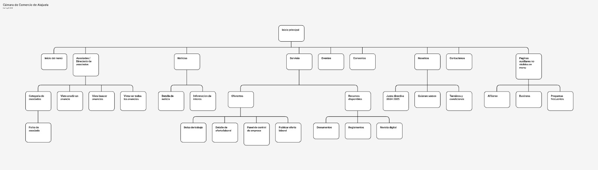
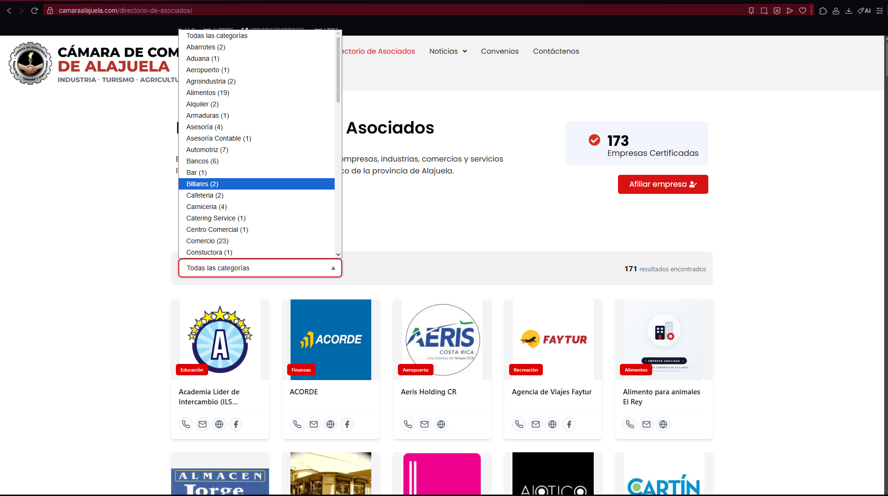
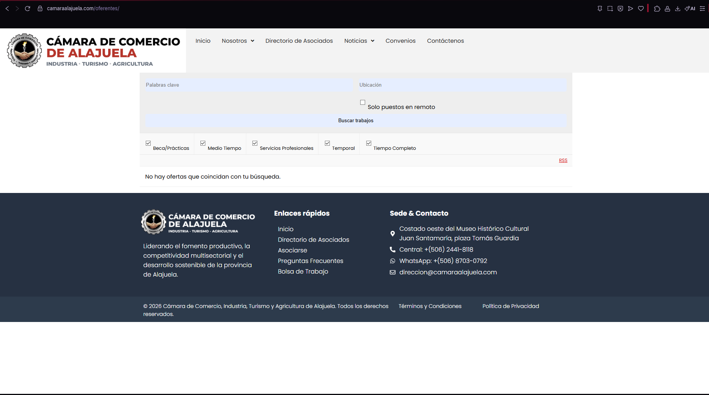
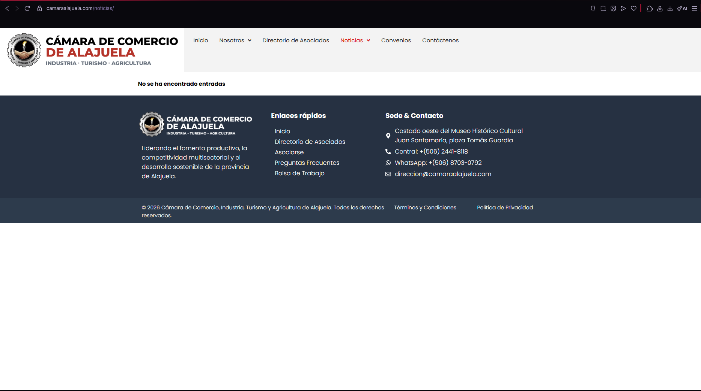
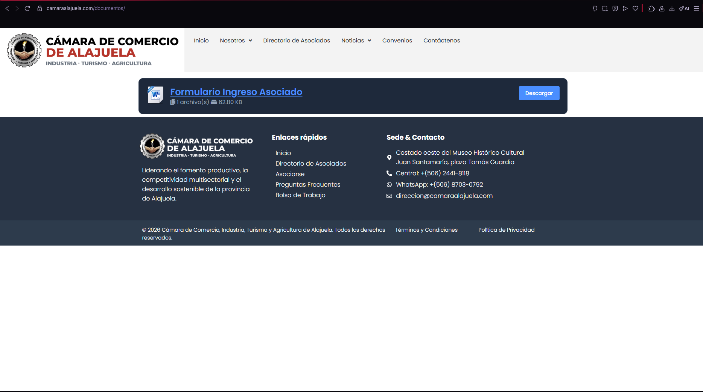
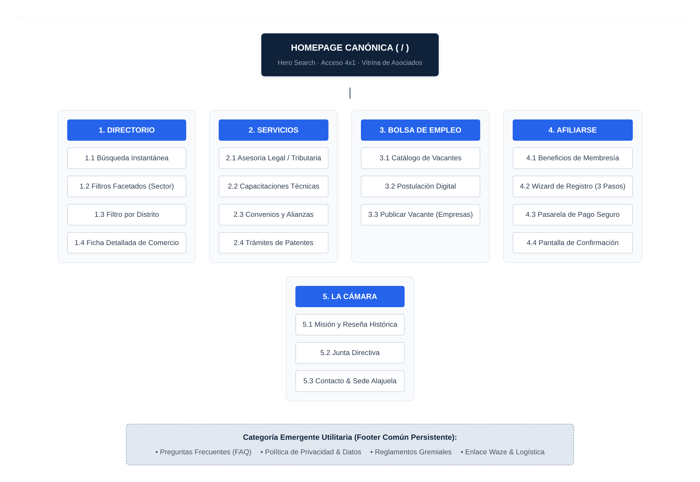

# 5. Resumen del Avance 1: Auditoría Inicial de Aspectos de Mejora y Diseño Estructural

## 5.1 Auditoría Inicial del Sitio Preexistente e Inventario de Contenidos Ruta por Ruta

En la primera fase de la consultoría se ejecutó un levantamiento forense de la estructura real del sitio web vigente de la Cámara de Comercio de Alajuela (`www.camaraalajuela.com`) con el propósito de mapear todos sus nodos activos, auditar el estado de sus contenidos y fundamentar los aspectos de mejora antes de plantear cualquier rediseño.

El diagrama levantado durante la auditoría inicial (véase la Figura 5.1) evidenció una arquitectura desarticulada de cuatro niveles con severas anomalías taxonómicas:
1. **Bucle de inicio duplicado:** Bajo el nodo raíz *«Inicio principal»* colgaba como hijo de primer nivel el nodo *«Inicio del menú»* (`/home`), generando una doble portada con menús y banners desincronizados.
2. **Desconexión de servicios gremiales:** Mientras que *«Eventos»* y *«Convenios»* figuraban como nodos sueltos en el primer nivel sin páginas hijas, el nodo *«Servicio»* escondía en un tercer y cuarto nivel los subárboles de *«Oferentes»* (*Bolsa de trabajo*, *Detalle de oferta laboral*, *Panel de control de empresa*, *Publicar oferta laboral*) y *«Recursos disponibles»* (*Documentos*, *Reglamentos*, *Revista digital*).
3. **Exposición de vistas administrativas en el Directorio:** Bajo *«Asociados / Directorio de asociados»* se exponían al público vistas crudas del plugin de WordPress (*«Vista añadir un anuncio»*, *«Vista buscar anuncios»*, *«Vista ver todos los anuncios»*), enterrando la *«Ficha de asociado»* hasta el cuarto nivel jerárquico tras pasar por *«Categoría de asociados»*.
4. **Mezcla de contenido institucional y legal:** El nodo *«Nosotros»* agrupaba *«Junta directiva 2024 2025»* y *«Quiénes somos»* junto con *«Términos y condiciones»*, ubicando un documento legal utilitario dentro de la rama de identidad corporativa.
5. **Páginas huérfanas y ocultamiento de la conversión:** Existía un grupo completo denominado *«Páginas auxiliares no visibles en menú»* donde se encontraban ocultos el flujo estratégico de *«Afiliarse»*, la sección de *«Preguntas frecuentes»* y una página residual de plantilla en idioma inglés titulada *«Business»*.

Una vez diagramado el árbol preexistente, se inspeccionó cada ruta activa contrastando sus hallazgos contra las 10 Heurísticas de Usabilidad de Nielsen (Quiñones et al., 2023) para determinar la acción correctiva en el sistema.

**Tabla 2.**  
*Inventario forense ruta por ruta, heurísticas vulneradas y aspectos de mejora implementados*

| Ruta Auditada | Contenido Encontrado en la Auditoría Inicial | Heurística de Nielsen Vulnerada y Diagnóstico | Aspecto de Mejora Implementado en el Sistema |
| :--- | :--- | :--- | :--- |
| **`/` y `/home`** | Coexistencia de dos portadas con 24 bloques desordenados, carruseles rotos y enlaces vacíos (`#`). | **H4 (Consistencia y estándares):** Confunde al usuario sobre su ubicación real y canibaliza el posicionamiento SEO. | Unificación en una única Homepage canónica (`/`) con 6 bloques jerárquicos y redirección HTTP 301 desde `/home` y `camara-alajuela.com`. |
| **`/quienes-somos/`** | Bloque monolítico de texto estático sin jerarquía tipográfica y mezclado con términos legales. | **H8 (Diseño estético y minimalista):** Sobrecarga cognitiva por fatiga de lectura y falta de escaneabilidad visual. | Reestructuración bajo la rama *La Cámara* en secciones diferenciadas de Historia (1983), Misión/Visión, Junta Directiva y Transparencia. |
| **`/noticias/`** | Página vacía que arrojaba el aviso crudo de WordPress: *«No se han encontrado entradas»*. | **H6 (Reconocimiento antes que recuerdo):** Promesa rota en el menú principal que proyecta abandono institucional. | Sustitución por módulo dinámico de comunicados gremiales, eventos y edición de Revista Digital administrado desde CMS. |
| **`/oferentes/`** | Pantalla vacía con el error *«No hay ofertas que coincidan con tu búsqueda»* y subpáginas inoperantes. | **H5 (Prevención de errores):** Invita al ciudadano y al agremiado a interactuar con un servicio desconectado. | Refundación completa como rama primaria *Bolsa de Empleo* con catálogo de vacantes activas, filtros y formulario de postulación. |
| **`/directorio-de-asociados/`** | 171 comercios en 64 categorías sin normalizar, vistas crudas de plugin, 4 clics ciegos y rastro `directorio-asociados-old`. | **H7 (Flexibilidad y eficiencia de uso):** Ausencia de buscador tolerante a errores y 0 % de filtros por cantón o distrito. | Implementación de motor de búsqueda instantánea con 12 sectores normalizados, facetas geográficas y contacto directo por WhatsApp. |
| **`/documentos/`** | Único enlace a un archivo Word/PDF de 62.80 KB (*«Formulario Ingreso Asociado»*) para imprimir. | **H2 (Relación entre el sistema y el mundo real):** Etiqueta ambigua y trámite físico que frena la conversión gremial. | Descomposición en Ventanilla Digital de Trámites/Patentes Municipales y traslado de estatutos a su sección normativa. |
| **`/afiliarse/` y `/business/`** | Páginas huérfanas ocultas fuera del menú principal junto con residuos de plantilla en idioma inglés. | **H1 (Visibilidad del estado) y H4 (Estándares):** El trámite de mayor valor económico carecía de acceso visible. | Depuración total de `/business/` y elevación de *Afiliarse* como botón CTA persistente con wizard digital de 3 pasos y pago SINPE. |
| **`/contacto/`** | Formulario genérico sin validación reactiva y número telefónico fijo sin geolocalización interactiva. | **H9 (Ayuda para reconocer y recuperar errores):** Sin retroalimentación de envío ni canales ágiles de atención. | Integración de atención directa por WhatsApp, botones de ruta en Waze/Google Maps y asistente virtual RAG 24/7. |

### Evidencias Visuales de la Auditoría sobre el Sitio Web Original (`camaraalajuela.com`)

Las capturas tomadas directamente sobre el portal original respaldan empíricamente cada patología documentada en la matriz forense:
1. **En la Portada Original (`camaraalajuela.com` — Figura 5.2):** El menú principal (*Inicio, Nosotros, Directorio de Asociados, Noticias, Convenios, Contáctenos*) omite por completo el acceso a la *Bolsa de Empleo* y al flujo de *Afiliarse*, mientras que el indicador inferior declara **«185 Asociados»**, cifra que contradice los conteos internos del directorio.
2. **En el Directorio de Asociados (`camaraalajuela.com/directorio-de-asociados/` — Figura 5.3):** En una misma vista coexisten dos cifras contradictorias (**«173 Empresas Certificadas»** en el recuadro superior y **«171 resultados encontrados»** en la barra gris). Además, no existe barra de búsqueda por texto ni filtro por cantón o distrito, y el selector desplegable exhibe 64 categorías sin control taxonómico que mezclan inglés y español (*«Catering Service»*), omiten tildes (*«Cafeteria»*, *«Carniceria»*), duplican ramas (*«Asesoría»* vs. *«Asesoría Contable»*) e incluyen errores ortográficos visibles como **«Constuctora (1)»**.
3. **En la Bolsa de Empleo (`camaraalajuela.com/oferentes/` — Figura 5.4):** La interfaz invita al visitante a buscar empleo, pero devuelve invariablemente el aviso **«No hay ofertas que coincidan con tu búsqueda»**.
4. **En la Sección de Noticias (`camaraalajuela.com/noticias/` — Figura 5.5):** El enlace del menú principal conduce a una página en blanco con el mensaje crudo de WordPress **«No se ha encontrado entradas»**.
5. **En el Repositorio de Documentos (`camaraalajuela.com/documentos/` — Figura 5.6):** La sección carece de reglamentos o guías municipales y aloja únicamente un archivo descargable de Word de `62.80 KB` titulado **«Formulario Ingreso Asociado»**.

## 5.2 Diagnóstico de Aspectos de Mejora por Sistema de Arquitectura de Información y Matriz ROT

Para estructurar la intervención consultora, los hallazgos del inventario inicial se agruparon bajo los cuatro sistemas fundamentales de Morville y Rosenfeld (2015) y se sometieron a una auditoría de contenido **ROT (*Redundant, Outdated, Trivial*)**, determinando qué elementos debían eliminarse, refundarse o normalizarse.

**Tabla 3.**  
*Auditoría de aspectos de mejora según los cuatro sistemas de Arquitectura de Información y criterio ROT*

| Sistema de AI / Criterio | Deficiencia Detectada en la Auditoría Inicial | Aspecto de Mejora y Regla de Diseño Aplicada |
| :--- | :--- | :--- |
| **1. Sistema de Organización** | Dispersión temática (*Servicio*, *Eventos* y *Convenios* separados en nivel 1) y mezcla de páginas legales con institucionales en *Nosotros*. | Adopción de un **esquema híbrido**: exacto (alfabético y geográfico por cantón/distrito en el Directorio) y ambiguo (por tópico y tarea en las 5 ramas del menú). |
| **2. Sistema de Etiquetado** | Rótulos técnicos de plugin (*«Vista añadir un anuncio»*), términos en inglés (*«Business»*, *«Read More»*) y 64 categorías con errores (*«Constuctora»*). | Creación de un **vocabulario controlado costarricense** en español claro y consolidación de las 64 categorías abiertas en 12 sectores económicos canónicos. |
| **3. Sistema de Navegación** | Profundidad excesiva de 4 niveles para ver un comercio, carencia de migas de pan (*breadcrumbs*) y páginas huérfanas sin enlace de retorno. | Aplicación de la **Ley de Hick** (máximo 5 ramas primarias + 1 CTA) y regla de **profundidad máxima de 3 niveles**, garantizando acceso a cualquier tarea en ≤ 3 clics. |
| **4. Sistema de Búsqueda** | Buscador nativo de WordPress limitado a coincidencia exacta de subcadenas; un error ortográfico o sinónimo devolvía cero resultados. | Diseño de índice invertido con tolerancia tipográfica (distancia Damerau-Levenshtein), 52 grupos de sinónimos locales y facetas conjuntivas/disyuntivas. |
| **Auditoría ROT — Redundante** | Portada duplicada `/home`, directorio antiguo `directorio-asociados-old` y categorías repetidas en singular/plural. | Eliminación física de rutas duplicadas, redirección permanente HTTP 301 hacia rutas canónicas y fusión de categorías equivalentes. |
| **Auditoría ROT — Obsoleto** | Secciones `/noticias/` y `/oferentes/` sin registros activos, PDF de afiliación manual de 62 KB y periodo vencido *«Junta directiva 2024 2025»*. | Reactivación con colecciones dinámicas en CMS, caducidad automática de vacantes vencidas y digitalización del trámite de afiliación. |
| **Auditoría ROT — Trivial** | Página huérfana `/business/` y 14 bloques de plantilla en inglés (*«Join the community»*, *«Meet our team»*) sin valor para el comerciante. | Purga integral de páginas y contenedores de relleno, preservando únicamente bloques con utilidad informativa o transaccional verificada. |

## 5.3 Reestructuración del Sitemap Macro en FlowMapp y Microarquitectura en Octopus.do

### Modelado del Sitemap Macro en FlowMapp (Semana 4)
Con base en los aspectos de mejora diagnosticados, se diseñó en FlowMapp el nuevo plano estructural del portal (véase la Figura 5.7). Se sustituyó el árbol desarticulado anterior por una taxonomía balanceada de **26 nodos informativos distribuidos en un máximo de 3 niveles de profundidad**, organizados en cinco ramas maestras y un bloque utilitario de pie de página:
- **Rama 1 — Inicio (`/`):** Portada canónica unificada con buscador central conectado al directorio, tres pilares de valor gremial y accesos rápidos a trámites.
- **Rama 2 — Directorio Comercial (`/directorio`):** Buscador predictivo de los 171 comercios certificados, filtros facetados por cantón/sector y ficha detallada de empresa a un clic de distancia.
- **Rama 3 — Servicios (`/servicios`):** Agrupación cohesiva de Asesoría Legal y Arbitraje, Capacitaciones, Convenios Comerciales y Ventanilla de Trámites/Patentes Municipales.
- **Rama 4 — Bolsa de Empleo (`/empleo`):** Catálogo de ofertas laborales provinciales, filtro por área ocupacional, postulación de currículum y panel de publicación para empresas agremiadas.
- **Rama 5 — La Cámara (`/la-camara`):** Reseña histórica desde 1983, Misión y Visión, Junta Directiva actualizada y sección de Transparencia institucional.
- **Acción Primaria (`Afiliarse`) y Pie Utilitario (*Footer*):** El flujo de afiliación (antes oculto fuera del menú) se elevó a botón de llamada a la acción permanente con su wizard de 3 pasos, mientras que *Preguntas Frecuentes (FAQ)*, *Política de Privacidad* y *Reglamentos* se consolidaron en el pie de página transversal.

### Microarquitectura de Bloques y Auditoría de Limpieza en Octopus.do (Semana 5)
Posteriormente, se utilizó **Octopus.do** para definir la anatomía interna de cada una de las 26 páginas mediante bloques funcionales modulares (*content wireflows*), reduciendo la saturación de la portada antigua de 24 elementos desordenados a 6 bloques jerárquicos escaneables. Durante esta fase se ejecutó una segunda auditoría técnica sobre el archivo de microarquitectura antes de su exportación a diseño visual:
1. **Depuración de contaminación de plantilla en inglés:** Se detectó que 14 de las 26 páginas generadas en Octopus.do arrastraban bloques predeterminados en idioma inglés (tales como *«Discover our services»* en Inicio, *«Meet our partners»* en Directorio y *«Join the community»* en Afiliación). Todos fueron auditados y sustituidos por nomenclatura institucional en español.
2. **Neutralización de nodo duplicado en metadatos:** Se identificó y eliminó un nodo residual de *«Contacto»* que había quedado desconectado del árbol central durante la importación.
3. **Sincronización vectorial hacia Figma:** Una vez saneada la microarquitectura, la estructura de 26 páginas se exportó mediante el plugin oficial *Octopus.do to Figma* en un lienzo vectorial de `3200 × 2376 píxeles`, sirviendo como plano estructural exacto para los wireframes de alta fidelidad.
