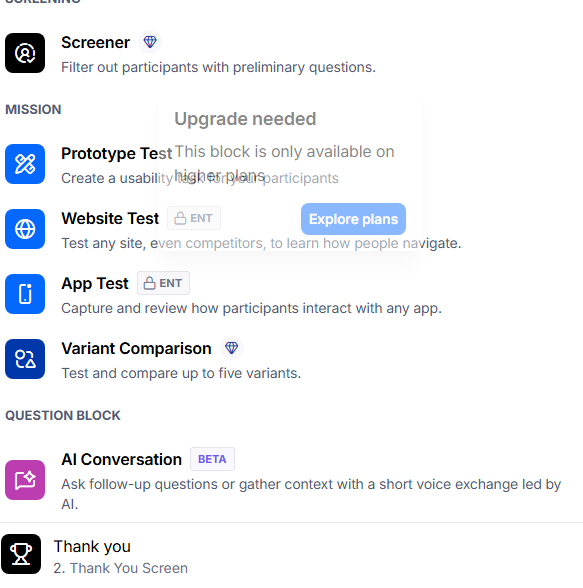
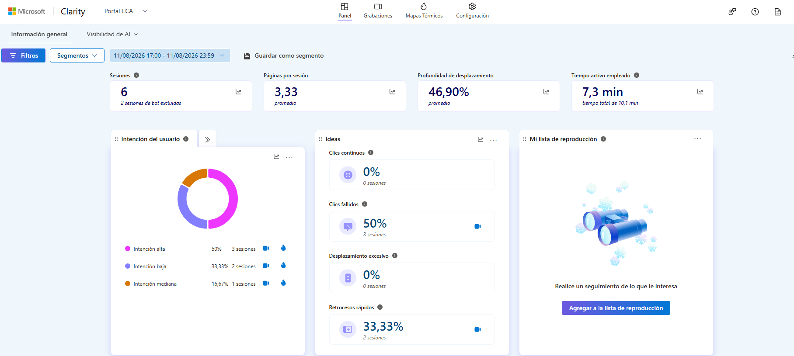
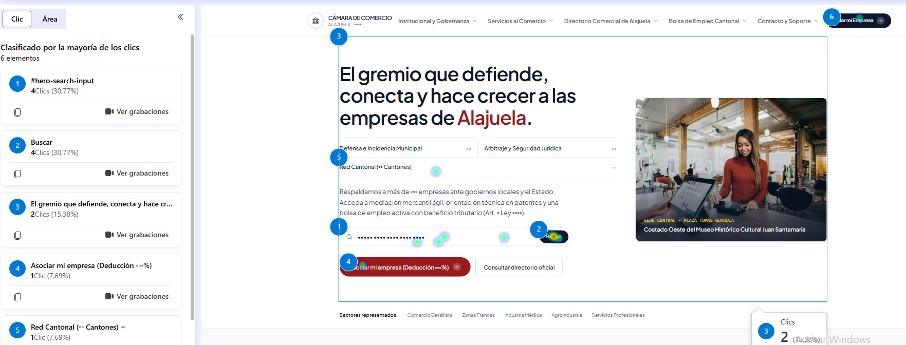
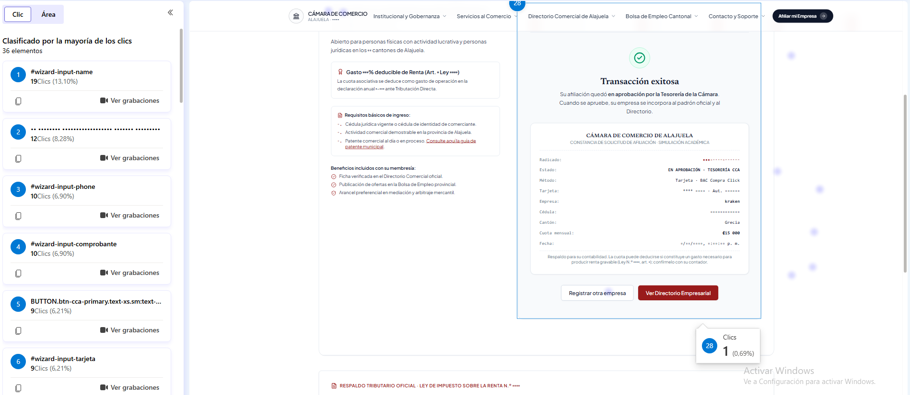

# 8. Evaluación de Usabilidad, Fricción y Analítica Comportamental (Microsoft Clarity + SUS)

## 8.1 Marco conceptual y herramientas

La usabilidad es el grado en que usuarios específicos logran objetivos concretos con efectividad, eficiencia y satisfacción en un contexto de uso determinado (ISO 9241-11:2018). Para contrastar empíricamente la propuesta de Arquitectura de Información del portal de la Cámara de Comercio de Alajuela (CCA) se combinaron tres instrumentos, cada uno para una dimensión distinta:

| Dimensión ISO 9241-11 | Instrumento | Qué mide |
|---|---|---|
| Efectividad | Misiones guiadas (Google Forms) | Éxito por misión, verificado contra la respuesta escrita (comercio encontrado, número de radicado) |
| Eficiencia y fricción | **Microsoft Clarity** sobre el sitio publicado | Tiempo activo, páginas por sesión, mapas de calor de clics, *rage clicks*, *dead clicks* y *quick backs* |
| Satisfacción | **SUS** (Brooke, 1996) + **SEQ** por misión (Sauro & Dumas, 2009) | Percepción global (0–100) y facilidad percibida de cada misión (1–7) |

**Microsoft Clarity** registra de forma pasiva y anónima las interacciones con el DOM del navegador: reconstruye grabaciones de sesión, genera mapas de calor y detecta automáticamente señales de fricción (Microsoft, 2025):

* **Clics de furia (*rage clicks*):** varias pulsaciones rápidas sobre la misma zona; el usuario espera una respuesta que no llega.
* **Clics muertos (*dead clicks*):** clics sobre elementos que no producen ninguna acción, señal de una *affordance* engañosa.
* **Retrocesos rápidos (*quick backs*):** el usuario entra a una página y regresa de inmediato; la etiqueta prometía algo que la página no entregó.

**System Usability Scale (SUS).** Escala de 10 reactivos (1–5) que alterna afirmaciones positivas y negativas. El puntaje se normaliza a 0–100; 68 es el promedio de la industria (Sauro, 2011) y en la escala curva de Sauro y Lewis (2016) un puntaje ≥ 84.1 corresponde al grado A+.

### 8.1.1 Por qué no se usó Maze

El enunciado propone Maze. Se creó la cuenta y se verificó que el plan gratuito solo ofrece *Screener*, *Prototype test* (prototipos de Figma) y *Variant comparison*; la prueba sobre un **sitio web publicado** (*Website test*) exige el plan Enterprise (Figura 8.0). Como el portal ya está implementado y desplegado (https://cca-alajuela-portal.vercel.app), evaluar un prototipo de Figma habría medido un artefacto distinto al que se entrega. Se mantuvieron **las dos misiones del enunciado** y se sustituyó Maze por la combinación Google Forms (misiones + SUS) + Microsoft Clarity (comportamiento), ambas gratuitas.

*Figura 8.0.* Maze: la prueba sobre sitio web requiere plan Enterprise.

---

## 8.2 Diseño de la prueba

| Elemento | Detalle |
|---|---|
| Tipo | Prueba remota **no moderada** sobre el sitio real, 8 de noviembre de 2026 |
| Participantes | N = 5 (P1–P5). Nielsen y Landauer (1993) muestran que 5 usuarios detectan cerca del 85 % de los problemas de usabilidad de un diseño |
| Perfil | Edades de 18–25 (2), 26–35, 36–50 y 51 o más; 4 en computadora y 1 en celular; frecuencia de trámites en línea: nunca (1), a veces (3), frecuentemente (1) |
| Instrumentos | Formulario de Google sin inicio de sesión (`tools/05_maze_y_clarity/crear_formulario.gs`) + Clarity (proyecto `zaksg7xnz7`) |
| Guía del facilitador | `tools/05_maze_y_clarity/PRUEBA_USABILIDAD_REAL.md` |

**Misiones (iguales para todos, en este orden):**

1. **Misión 1 · Comercio gastronómico.** "Quiere almorzar en Alajuela en un lugar afiliado a la Cámara. Use el portal para encontrar un restaurante o soda afiliado y anote su nombre y teléfono." Evalúa el buscador y el directorio (Cap. 9).
2. **Misión 2 · Afiliación digital.** "Afilie su negocio ficticio *Soda La Prueba* al plan Comercio y Pyme y pague con tarjeta. Use primero la tarjeta 4000 0000 0000 0002; si no funciona, termine como pueda. Anote el radicado." La primera tarjeta está **programada para ser rechazada**: la misión mide si el usuario se recupera del error sin ayuda (Cap. 13).

Después de cada misión el participante indicó si la completó y su facilidad (SEQ, 1–7); al final respondió el SUS y dos preguntas abiertas.

---

## 8.3 Resultados de las misiones y del SUS

Las respuestas se procesaron con `tools/05_maze_y_clarity/calcular_resultados.py` (anexo: `anexo_8_respuestas_prueba_usabilidad.csv`).

#### Tabla 8.1. *Resultado por misión (N = 5)*

| Misión | Éxito autodeclarado | Éxito verificado | SEQ promedio (1–7) |
|---|---|---|---|
| M1 · Restaurante o soda afiliado | 5/5 | 5/5 encontraron un afiliado del sector *Alimentos y Gastronomía* que existe en el directorio. Con el criterio estricto "restaurante o soda": **3/5** (P4 anotó una cafetería y P5 una panadería) | **6.2** |
| M2 · Afiliación + pago | 5/5 | **5/5** anotaron un radicado válido (formato CCA-2026-######) | **6.4** |

**Recuperación del error de pago (M2).** 4 de los 5 participantes recibieron el rechazo de la tarjeta de prueba y **todos cambiaron de tarjeta y terminaron la afiliación sin ayuda** ("cambié de tarjeta", "cambiar el número de tarjeta por uno válido"). P3 usó directamente la tarjeta válida y no vio el rechazo. El mensaje de error ("fondos insuficientes; intente con otra tarjeta o pague por SINPE Móvil") cumplió su función de indicar la salida.

#### Tabla 8.2. *System Usability Scale por participante*

| Participante | P1 | P2 | P3 | P4 | P5 | **Promedio** |
|---|---|---|---|---|---|---|
| SUS | 85.0 | 85.0 | 97.5 | 97.5 | 100.0 | **93.0** (DE 7.4) |

El SUS promedio de **93.0** supera ampliamente el promedio de la industria (68) y cae en el grado **A+** de la escala de Sauro y Lewis (2016). El puntaje más bajo (85.0) es el de P2 (51 años o más, nunca hace trámites en línea) y P1; aun así ambos están por encima de 84.1. **Limitación:** con N = 5 el intervalo de confianza es amplio y los participantes pertenecen al círculo cercano del equipo, lo que puede inflar la satisfacción; el valor debe leerse como indicativo, no como una medición poblacional.

---

## 8.4 Diagnóstico de fricción con Microsoft Clarity

Ventana analizada: 8/11/2026, 17:00–23:59 (cubre las cinco sesiones de prueba; las respuestas del formulario van de 17:47 a 21:59).

#### Tabla 8.3. *Métricas de comportamiento (Clarity)*

| Métrica | Valor | Lectura |
|---|---|---|
| Sesiones | 6 (2 de bots excluidas) | 5 participantes + 1 sesión adicional (recarga o facilitador) |
| Páginas por sesión | 3.33 | Recorrido corto: Inicio → Directorio/Afiliación |
| Tiempo activo promedio | 7.3 min | Para dos misiones completas |
| Profundidad de desplazamiento | 46.9 % | Los usuarios no necesitaron recorrer toda la página |
| Clics de furia | **0 %** | Ningún elemento dejó de responder |
| Clics muertos | **50 %** (3 sesiones) | Ver análisis del mapa de calor |
| Retrocesos rápidos | **33.3 %** (2 sesiones) | Ver hallazgos |

*Figura 8.1.* Panel de Clarity durante la ventana de prueba.

**Mapa de calor de Inicio (13 clics).** El 61.5 % de los clics de la portada fue al buscador (4 en la caja `#hero-search-input` y 4 en el botón *Buscar*): la Misión 1 se resolvió **buscando**, no navegando el menú, lo que valida la decisión de poner el buscador conectado a Algolia en la portada (Cap. 9). Los clics restantes cayeron en el título principal (2) y en la fila "Red Cantonal" (1), que son **texto no interactivo**: son los candidatos a los *dead clicks* registrados.

*Figura 8.2.* Mapa de calor de clics, página de Inicio.

**Mapa de calor de Afiliación (145 clics en 36 elementos).** Los clics se concentran en los campos del formulario (nombre 19, teléfono 10). Destaca que el campo **comprobante SINPE recibió 10 clics, tantos como el de tarjeta (9)**, aunque la misión pedía pagar con tarjeta: SINPE es la pestaña por defecto y varios participantes empezaron a llenarla antes de cambiar a *Tarjeta*. Esto coincide con el comentario de P1: "no se separaba el número de comprobante en el formato que se pide".

*Figura 8.3.* Mapa de calor de clics, página de Afiliación (paso de pago y constancia).

---

## 8.5 Hallazgos y recomendaciones

| # | Hallazgo (evidencia) | Severidad | Recomendación |
|---|---|---|---|
| H1 | El buscador concentra el 61.5 % de los clics de Inicio y M1 obtuvo SEQ 6.2 (Fig. 8.2, Tabla 8.1) | Positivo | Mantener el buscador como punto de entrada principal |
| H2 | 2 de 5 eligieron una cafetería o panadería cuando se pidió "restaurante o soda" (Tabla 8.1) | Baja | Mostrar la categoría (Restaurante, Cafetería, Panadería) como etiqueta visible y como filtro en el directorio |
| H3 | El rechazo de pago fue superado por 4/4 participantes que lo vieron (Tabla 8.1) | Positivo | Conservar el mensaje que explica la causa y ofrece la alternativa |
| H4 | Clics en textos no interactivos del Hero (título, "Red Cantonal") → 50 % de sesiones con *dead clicks* (Fig. 8.1, 8.2) | Media | Enlazar "Red Cantonal" a la página de cantones o quitarle la apariencia de fila de lista |
| H5 | Se interactuó con el campo de comprobante SINPE aunque la misión era con tarjeta; P1 reportó confusión con su formato (Fig. 8.3) | Media | Recordar el último método usado o preguntar el método antes del formulario; aceptar el comprobante con espacios o guiones y normalizarlo |
| H6 | 33 % de sesiones con retroceso rápido (Fig. 8.1) | Baja | Revisar las grabaciones de esas sesiones; con N = 5 son 2 casos |

**Conclusión.** Con datos reales de cinco participantes, el portal obtuvo un SUS de 93.0, éxito de 5/5 en la misión de afiliación y pago, y 0 % de clics de furia. Los puntos de fricción detectados son concretos y de bajo costo de corrección (H2, H4, H5). Por el tamaño de la muestra, estos resultados deben confirmarse con usuarios reales de la Cámara antes del lanzamiento.

---

## 8.6 Referencias

* Brooke, J. (1996). SUS: A "quick and dirty" usability scale. En P. W. Jordan, B. Thomas, B. A. Weerdmeester & I. L. McClelland (Eds.), *Usability evaluation in industry* (pp. 189–194). Taylor & Francis.
* International Organization for Standardization. (2018). *ISO 9241-11:2018. Ergonomics of human-system interaction — Part 11: Usability: Definitions and concepts*. ISO.
* Microsoft. (2025). *Microsoft Clarity documentation*. https://learn.microsoft.com/en-us/clarity/
* Nielsen, J., & Landauer, T. K. (1993). A mathematical model of the finding of usability problems. En *Proceedings of the INTERACT '93 and CHI '93 Conference on Human Factors in Computing Systems* (pp. 206–213). ACM.
* Sauro, J. (2011). *A practical guide to the System Usability Scale*. Measuring Usability LLC.
* Sauro, J., & Dumas, J. S. (2009). Comparison of three one-question, post-task usability questionnaires. En *Proceedings of the SIGCHI Conference on Human Factors in Computing Systems* (pp. 1599–1608). ACM.
* Sauro, J., & Lewis, J. R. (2016). *Quantifying the user experience: Practical statistics for user research* (2.ª ed.). Morgan Kaufmann.
