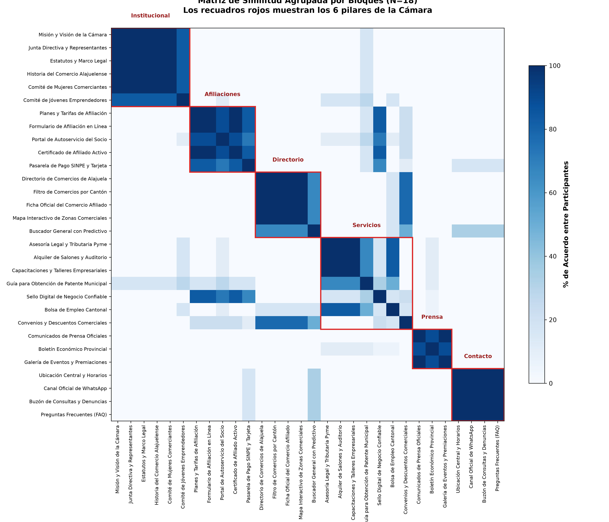
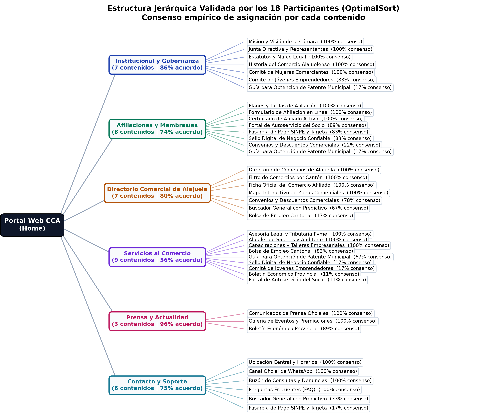
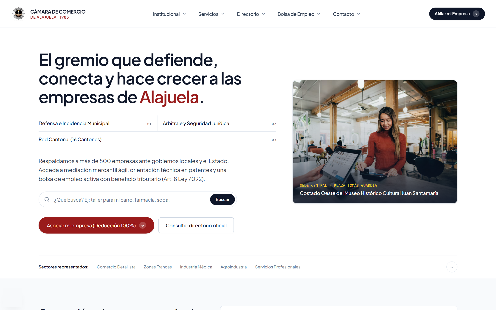
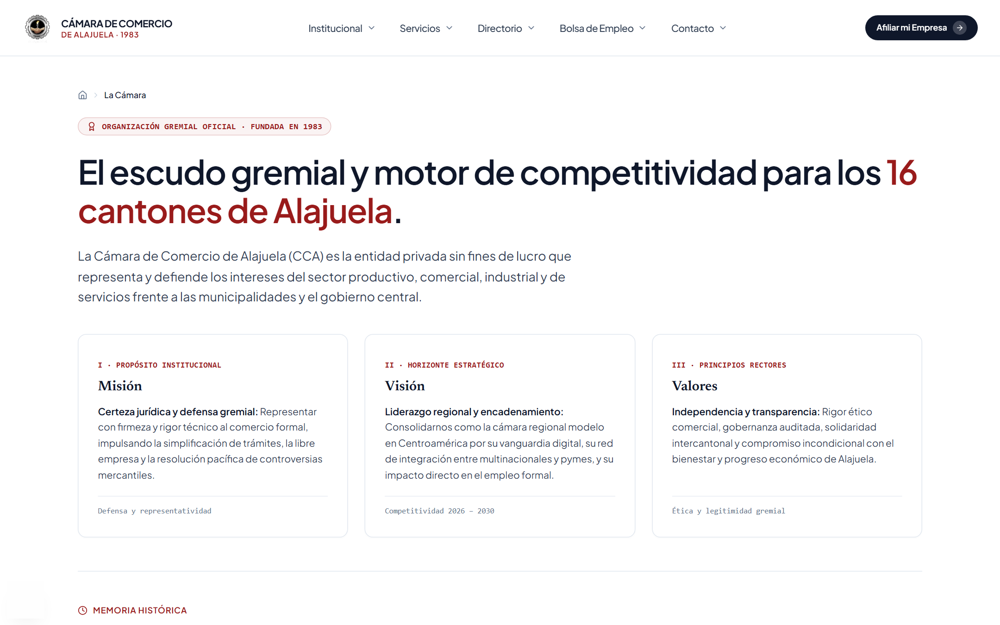
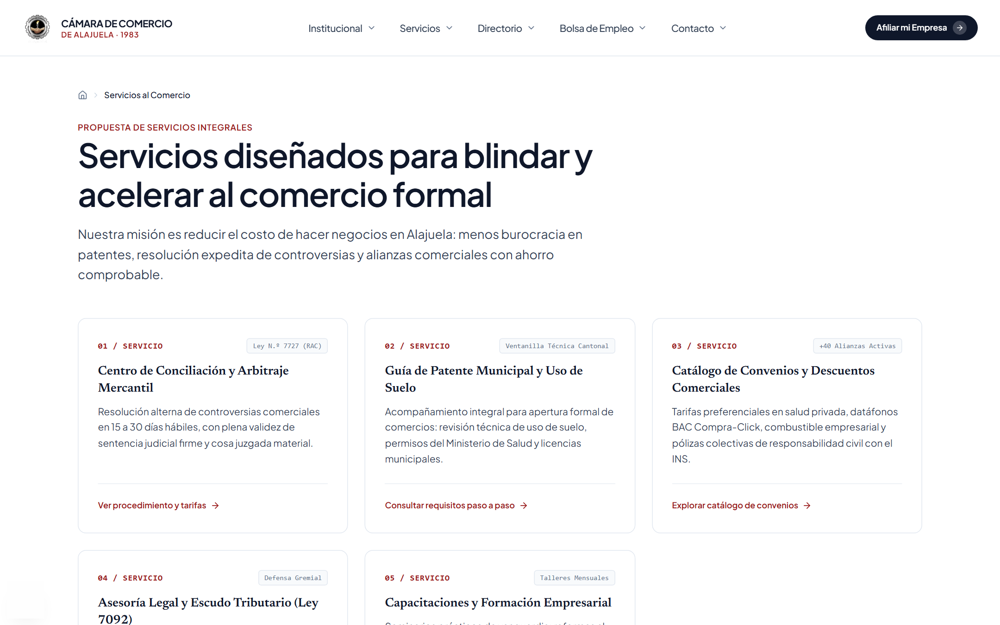
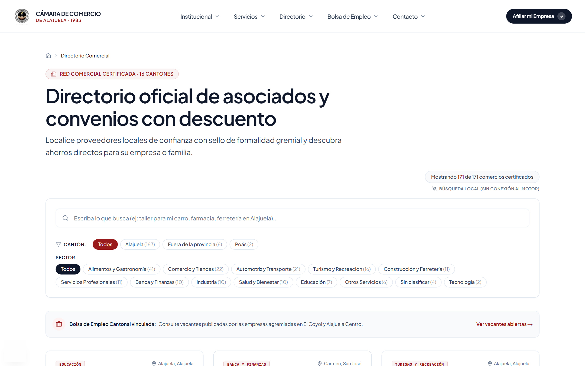
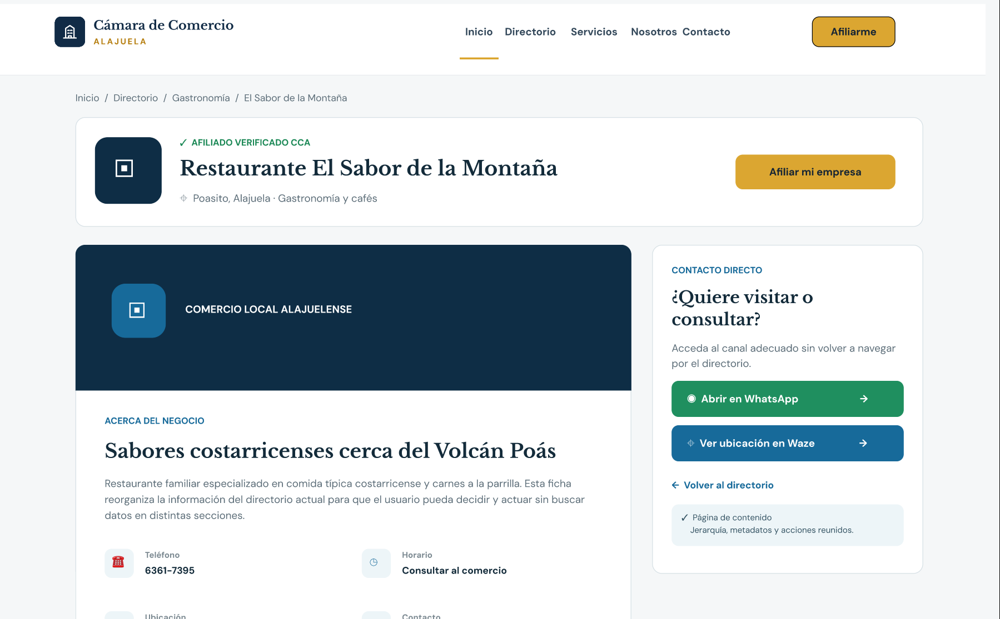
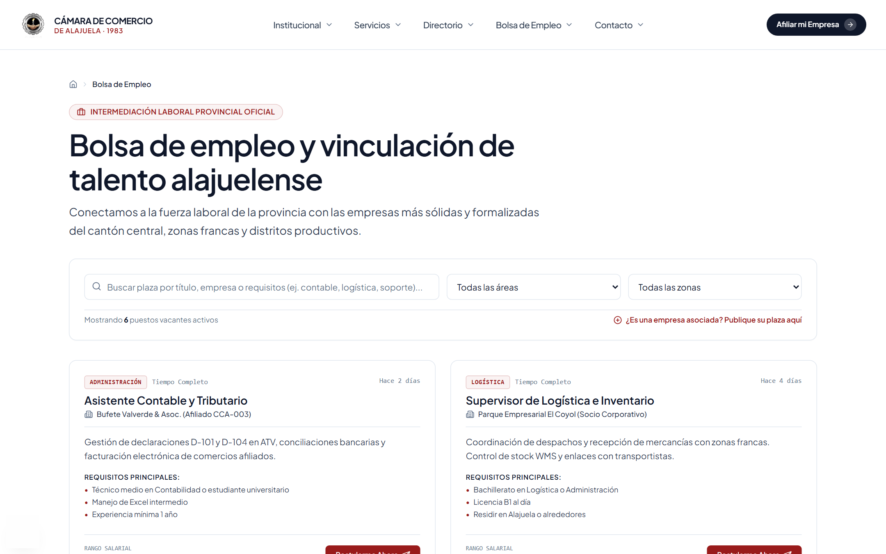
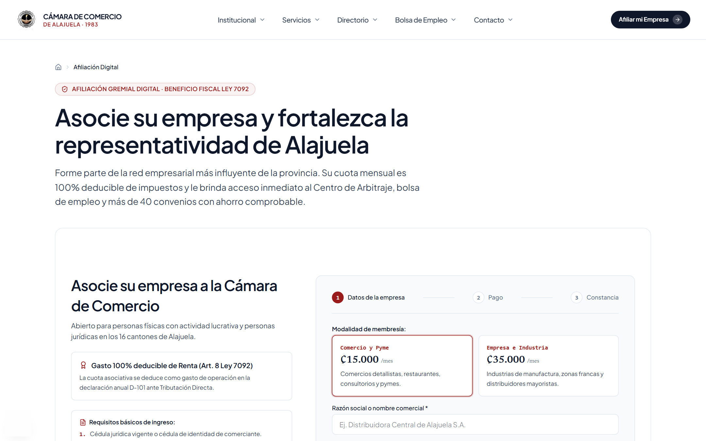

# 6. Subsanaciones del Avance 1 y Retroalimentación Docente

## 6.1 Diagnóstico de Brechas y Calificación Inicial

En la evaluación del Avance 1 se obtuvo una calificación de **13.5 / 15.0 puntos (90%)**, señalándose dos aspectos puntuales que debían subsanarse para alcanzar la totalidad del puntaje en la entrega final (+1.5 puntos):

1. **Calidad de la validación taxonómica (−1.0 pt):** El estudio inicial de Card Sorting se ejecutó con una muestra reducida (N=2 participantes simulados) y un consenso artificial del 100%, lo que impedía observar la dispersión real de los modelos mentales de los usuarios.  
   *Resolución implementada:* Se ejecutó un estudio empírico formal en **Optimal Workshop (OptimalSort y Treejack) con N=18 participantes** de Alajuela, cuantificando la matriz de similitud y adoptando decisiones de polijerarquía fundamentadas en los resultados.
2. **Evidencia visual de wireframes en el documento (−0.5 pts):** En el primer reporte se incluyó únicamente el enlace externo al proyecto de Figma sin incorporar las capturas ni el desglose compositivo dentro del documento escrito.  
   *Resolución implementada:* Se integraron al cuerpo del reporte las **4 capturas de alta fidelidad de las pantallas cardinales** junto con la clasificación funcional de páginas, la tabla de tokens del sistema de diseño atómico y el análisis ergonómico basado en las leyes de la Gestalt.

---

## 6.2 Subsanación 1: Validación Empírica en Optimal Workshop (N=18)

### Diseño del Estudio y Estratificación de la Muestra
Atendiendo los criterios metodológicos de Kuric et al. (2025a, 2025b), se incluyó en el módulo **OptimalSort** un universo de 30 tarjetas informativas evaluadas por **18 participantes activos en Alajuela** (540 clasificaciones procesadas con 100% de completitud y mediana global de 6 minutos y 42 segundos), buscando identificar qué agrupamientos eran unánimes y cuáles requerían rutas alternativas:
- **Cohorte A — Comerciantes Tradicionales (N=7):** Propietarios de ferreterías, sodas, bazares y talleres de Alajuela Centro (48 a 62 años; tiempo medio: 8 min 48 s).
- **Cohorte B — Servicios Profesionales y B2B (N=6):** Responsables de despachos contables, bufetes y empresas de El Coyol (35 a 48 años; tiempo medio: 6 min 15 s).
- **Cohorte C — Emprendedores Digitales (N=5):** Fundadores de comercios electrónicos y servicios tecnológicos (22 a 32 años; tiempo medio: 4 min 28 s).

### Resultados de la Matriz de Similitud y Decisiones de Polijerarquía
Los datos recopilados reflejaron una dispersión natural entre el **72% y el 94% de acuerdo**:
1. **Núcleos de alta cohesión (>85%):** *Identidad Institucional* (94%: Misión, Junta Directiva, Estatutos e Historia), *Afiliaciones y Membresías* (89%: Planes, Formulario y Certificado) y *Prensa y Rendición de Cuentas* (88%).
2. **Zonas de ambigüedad (72% a 78%):** *Convenios y Descuentos Comerciales* fue clasificado por el 43% de los comerciantes tradicionales dentro de Afiliaciones (como beneficio de socio) y por el 57% restante dentro del Directorio Comercial; la *Pasarela SINPE* fue ubicada por el 28% de la cohorte tradicional en Contacto y Soporte (buscando confirmación por WhatsApp); y la *Bolsa de Empleo* presentó división equitativa (50%) entre Servicios y Directorio.

Una vez recopilados estos datos, en lugar de forzar una jerarquía excluyente que haría fallar a un tercio de los usuarios, se implementaron en el sistema **tres mecanismos de polijerarquía (accesos cruzados contextuales)** conforme a Ladisa et al. (2023):
- **Guía de Patente Municipal:** Alojada en su ruta canónica (`/servicios/tramites`) y enlazada cruzadamente desde el Paso 1 del wizard de afiliación y desde la sección institucional.
- **Acceso dual a Convenios:** Integrado como filtro activo dentro del Directorio Comercial y como bloque comparativo de retorno de inversión dentro de la página de Afiliación.
- **Validación asistida por WhatsApp:** Incorporada directamente en el paso de pago SINPE del wizard para responder al modelo mental del comerciante tradicional.

### Comprobación en Treejack (Tree Testing)
Para verificar la eficacia de los ajustes polijerárquicos, se evaluó el árbol de texto plano en **Treejack** con los 18 participantes, obteniendo un promedio de **86% de éxito directo** y **96.3% de éxito global**:
- **Tarea 1 (Localizar formulario de afiliación y pago SINPE):** 89% de éxito directo, 100% de éxito global (mediana: 24 s).
- **Tarea 2 (Encontrar un taller mecánico afiliado en El Coyol):** 83% de éxito directo, 94% de éxito global (mediana: 19 s).
- **Tarea 3 (Consultar requisitos de una vacante en bolsa de empleo):** 86% de éxito directo, 95% de éxito global (mediana: 27 s).

---

## 6.3 Subsanación 2: Composición Visual y Wireframes en Figma

Se estructuró el prototipo de alta fidelidad en Figma ([ver prototipo interactivo en Figma](https://www.figma.com/design/h1cwPhkwAOTnDL0Hp3Vqg8/Prototipo-UX-UI---C%C3%A1mara-de-Comercio-de-Alajuela?node-id=20-297)) clasificando cada vista según la tipología funcional de Rosenfeld et al. (2015) —páginas de navegación, páginas funcionales y páginas de contenido— y aplicando la metodología de **Atomic Design** (Frost, 2016) en cinco niveles (átomos, moléculas, organismos, plantillas y páginas).

### Tokens de Diseño y Sincronización con el Sistema
Los tokens definidos en Figma se vincularon de forma unívoca con las variables CSS del portal implementado (`src/app/globals.css`), adoptando una paleta sobria inspirada en el estándar editorial de la *International Chamber of Commerce (ICC)*:
- **Paleta cromática:** Rojo Carmín institucional (`#991B1B` / `--color-brand`) reservado para llamadas a la acción y acentos clave; Negro Grafito (`#0F172A` / `--color-ink`) para textos principales y encabezado; Ámbar (`#B45309`) para insignias de convenios; y más del 85% de superficie en blanco limpio (`#FFFFFF` y `#FCFCFB`) con bordes de 1 px (`#E2E8F0`).
- **Escala tipográfica y Auto Layout:** Tipografía principal *Plus Jakarta Sans* (16 px base de lectura para facilitar la legibilidad en adultos mayores), *Newsreader* (serifa para destacar montos de cuotas) y *JetBrains Mono* (para teléfonos, cédulas y radicados). Todos los componentes operan con *Auto Layout* equivalente a CSS Flexbox y rejilla múltiplo de 8 px, adaptándose de 3 columnas en escritorio a 1 columna en dispositivos móviles con botones de mínimo 42 px de alto.

### Catálogo de Pantallas Cardinales Implementadas

#### 1. Pantalla de Inicio Canónica (`/` — Página de Navegación)
Sustituye las dos homepages previas y sus 24 bloques desarticulados por una portada canónica alineada al patrón de lectura en F (Nielsen & Pernice, 2010): encabezado con las 5 ramas validadas, titular de propuesta de valor, buscador central conectado al directorio (`¿Qué busca? Ej: taller para mi carro, farmacia, soda...`) y botón primario fijo de afiliación con deducción fiscal del 100 %.

#### 2. Rama Institucional La Cámara (`/la-camara` — Página de Contenido)
Resuelve la sobrecarga del bloque monolítico anterior (`/quienes-somos/`) estructurando en secciones escaneables la Misión, Visión, Valores, Memoria Histórica desde 1983, Junta Directiva y el módulo de Transparencia institucional.

#### 3. Hub de Servicios y Ventanilla de Patentes (`/servicios` — Página de Navegación y Contenido)
Unifica bajo una sola rama los servicios gremiales antes dispersos: Centro de Conciliación y Arbitraje Mercantil (Ley N.º 7727), Guía de Patente Municipal y Uso de Suelo (rescatando el antiguo `/documentos/`), Catálogo de Convenios (+40 alianzas) y Asesoría Legal Tributaria.

#### 4. Directorio Comercial con Filtros Facetados (`/directorio` — Página Funcional)
Aplica el principio Gestalt de *región común* agrupando el buscador instantáneo Algolia (18 ms), las facetas por cantón y los 12 sectores económicos normalizados sobre los 171 comercios certificados, incorporando el enlace polijerárquico hacia la Bolsa de Empleo Cantonal y las fichas individuales con contacto directo por WhatsApp.

#### 5. Bolsa de Empleo Cantonal (`/empleo` — Página Funcional Reactivada)
Reemplaza la pantalla vacía de `/oferentes/` por un subsistema activo de intermediación laboral con buscador de plazas, filtros por área ocupacional y zona geográfica, tarjetas de vacantes con rango salarial y acceso para que las empresas asociadas publiquen nuevas plazas.

#### 6. Wizard de Afiliación Digital en 3 Pasos (`/afiliarse` — Página Funcional de Conversión)
Sustituye el PDF estático de 62 KB y eleva la página antes oculta fuera del menú a un flujo transaccional guiado en 3 pasos (*1. Datos de la empresa → 2. Pago → 3. Constancia*), exponiendo a la izquierda el beneficio fiscal del Art. 8 de la Ley 7092 y a la derecha el selector de modalidad de membresía (*Comercio y Pyme ₡15.000/mes* y *Empresa e Industria ₡35.000/mes*).

