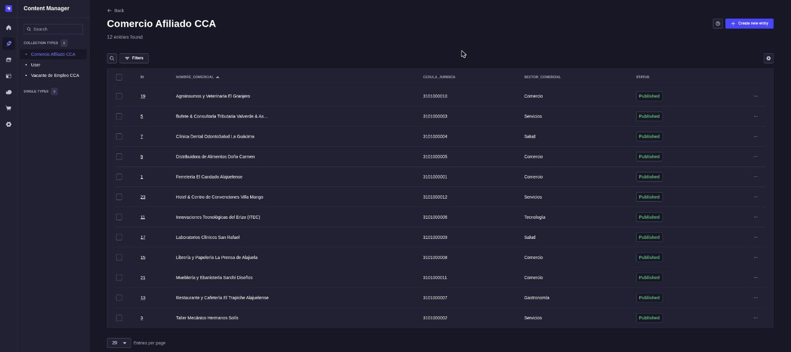
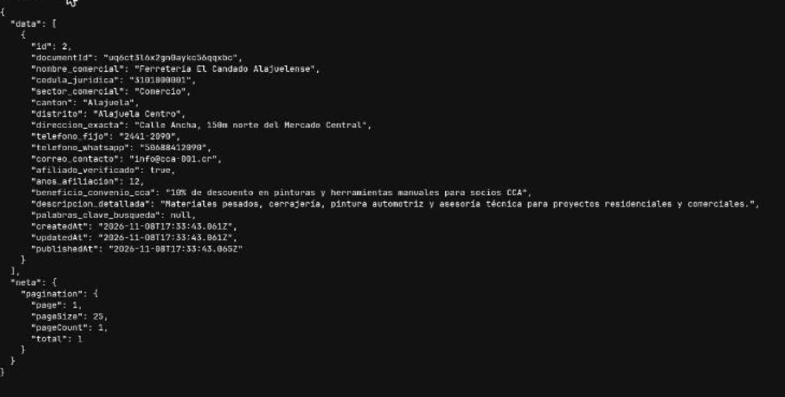

# 10. Metadatos, Vocabularios Controlados y CMS Headless (Strapi)

**Responsable:** Emanuel Soto · Consultor Especialista en Arquitectura de Contenidos y CMS

---

## 10.1 Justificación de la Arquitectura Desacoplada

En el sitio actual de la Cámara de Comercio de Alajuela (CCA), el contenido vive mezclado con la plantilla visual. Para agregar un comercio al directorio o publicar una vacante hay que recurrir a un programador externo o editar HTML. El resultado es visible: el directorio conserva comercios cerrados hace más de tres años y la bolsa de empleo muestra vacantes vencidas.

La propuesta separa dos capas que hoy están unidas:

- **Capa de contenido (Strapi):** guarda los comercios y las vacantes como registros con campos tipados, y el personal de la Cámara los administra desde un panel web.
- **Capa de presentación (portal web):** solo lee esos registros por medio de una API REST y decide cómo mostrarlos.

Esta separación aplica lo que Rosenfeld et al. (2015) plantean sobre los metadatos: cuando el contenido se describe con campos explícitos y vocabularios controlados, deja de depender de una página concreta y puede reutilizarse, filtrarse y buscarse de forma consistente.

**Tabla 10.1**
_Comparación entre el gestor actual y la arquitectura headless propuesta_

| Criterio | Sitio actual (WordPress con contenido en plantillas) | Propuesta (Strapi headless + portal web) |
| :-- | :-- | :-- |
| Quién actualiza el contenido | Un programador externo que edita la página. | El personal administrativo, desde formularios del panel. |
| Riesgo de alterar el diseño | Alto: el contenido y el HTML están en el mismo lugar. | Nulo: el editor solo llena campos; el diseño vive en el portal. |
| Consistencia de los datos | Texto libre, con errores como "Alajuel" o "San Ramon". | Listas cerradas que rechazan valores fuera del vocabulario. |
| Reutilización del contenido | Solo en la página donde se escribió. | El mismo registro alimenta el portal, el buscador Algolia y futuros canales. |
| Costo de licencia | Variable, según temas y plugins. | Strapi Community Edition es de código abierto y se instala en un servidor propio. |

Para un administrador de la Cámara, publicar un nuevo afiliado se reduce a abrir **Content Manager → Comercio Afiliado CCA → Create new entry**, llenar el formulario y pulsar **Publish**. Su tiempo de publicación se estima en unos 30 segundos, frente a las 72 horas actuales de espera a soporte técnico.

### Figura 10.1. Panel de administración de Strapi con los comercios afiliados



_Nota._ Vista del Content Manager de una instancia local de Strapi 5.61 con los 12 comercios cargados mediante `seed_strapi.js`. Cada registro muestra su cédula jurídica, su sector controlado y su estado de publicación. Elaboración propia.

---

## 10.2 Modelo de Datos para Comercio Afiliado

La entidad **Comercio Afiliado CCA** (`api::comercio.comercio`) representa cada empresa del directorio. Está definida en `comercio.schema.json` (Anexo) y tiene activado el modo borrador y publicación (_draft & publish_).

**Tabla 10.2**
_Atributos de la entidad Comercio Afiliado_

| Campo | Tipo de dato | Obligatorio | Reglas de validación |
| :-- | :-- | :-: | :-- |
| `nombre_comercial` | string | Sí | Único en toda la colección; máximo 150 caracteres. |
| `cedula_juridica` | string | Sí | Expresión regular `^[0-9]{10,12}$`: solo dígitos, entre 10 y 12. |
| `sector_comercial` | enumeration | Sí | Uno de los 5 sectores del vocabulario controlado (sección 10.4). |
| `canton` | enumeration | Sí | Uno de los 16 cantones de la provincia de Alajuela (sección 10.4). |
| `distrito` | string | Sí | Texto libre (por ejemplo, "El Coyol", "La Guácima"). |
| `direccion_exacta` | text | Sí | Dirección con señas, como se usa en Costa Rica. |
| `telefono_fijo` | string | No | — |
| `telefono_whatsapp` | string | Sí | Número en formato internacional (506…) para el botón de WhatsApp de la ficha. |
| `correo_contacto` | email | Sí | Debe tener formato de correo válido. |
| `afiliado_verificado` | boolean | No | Por defecto `true`; alimenta el sello "Afiliado verificado CCA". |
| `anos_afiliacion` | integer | No | Por defecto 1. |
| `beneficio_convenio_cca` | text | No | Descuento o convenio que el comercio ofrece a otros socios. |
| `descripcion_detallada` | richtext | No | Descripción con formato para la ficha del comercio. |
| `palabras_clave_busqueda` | json | No | Lista de términos adicionales para el buscador. |
| `vacantes` | relation (uno a muchos) | No | Vacantes de empleo publicadas por este comercio (sección 10.3). |

Además, Strapi agrega automáticamente los metadatos de sistema `documentId`, `createdAt`, `updatedAt` y `publishedAt`. Con ellos se puede auditar cuándo se registró o modificó cada comercio, y detectar fichas que llevan años sin actualizarse.

Las validaciones se comprobaron en la instancia local:

- Un comercio con el cantón "Alajuel" o "San Ramon" se rechaza siempre con un error de validación, incluso como borrador.
- La cédula con formato incorrecto (`3-101-000`) y el correo inválido se rechazan al **publicar**. Strapi permite guardarlos como borrador, de modo que el administrador puede dejar un registro a medias sin que llegue nunca al portal con datos mal formados.

---

## 10.3 Modelo de Datos para Bolsa de Empleo

La entidad **Vacante de Empleo CCA** (`api::vacante-empleo.vacante-empleo`) reemplaza la página estática de la bolsa de empleo. Está definida en `vacante_empleo.schema.json` (Anexo).

**Tabla 10.3**
_Atributos de la entidad Vacante de Empleo_

| Campo | Tipo de dato | Obligatorio | Reglas de validación / propósito |
| :-- | :-- | :-: | :-- |
| `titulo_puesto` | string | Sí | Nombre del puesto. |
| `empresa_empleadora` | string | Sí | Nombre visible de la empresa. |
| `comercio` | relation (muchos a uno) | No | Enlace al comercio afiliado que publica la vacante. |
| `jornada` | enumeration | Sí | Tiempo Completo, Medio Tiempo, Híbrido, Remoto o Pasantía. |
| `canton` | enumeration | Sí | Mismo vocabulario de 16 cantones que el comercio. |
| `salario_indicativo` | string | No | Rango salarial de referencia. |
| `descripcion_funciones` | richtext | Sí | Perfil del puesto: funciones principales. |
| `requisitos_minimos` | richtext | Sí | Perfil del puesto: formación y experiencia exigidas. |
| `correo_recepcion_cv` | email | Sí | Correo donde se reciben las postulaciones. |
| `fecha_cierre_postulacion` | date | Sí | Fecha de vigencia de la vacante. |

**Estados de publicación.** Cada vacante pasa por dos estados:

- **Borrador:** el empleador o el personal de la Cámara la redacta y revisa.
- **Publicada:** solo en este estado la API pública la entrega al portal.

Para retirar una vacante antes de tiempo basta con despublicarla.

**Vigencia temporal.** Como `fecha_cierre_postulacion` es obligatoria, ninguna vacante puede publicarse sin fecha de vencimiento. El portal pide únicamente las vacantes cuya fecha de cierre todavía no ha pasado:

```
GET /api/vacantes-empleo?filters[fecha_cierre_postulacion][$gte]=2026-11-08&populate[comercio][fields][0]=nombre_comercial
```

En la instancia local se cargaron dos vacantes de la Ferretería El Candado: una vigente hasta el 15/12/2026 y otra vencida el 31/10/2026. La consulta anterior devuelve solo la vigente, junto con el comercio que la publica (Anexo `payload_strapi_vacantes_vigentes.json`). Así, las vacantes vencidas desaparecen del portal sin que nadie tenga que borrarlas, y quedan guardadas en Strapi como historial.

---

## 10.4 Taxonomías y Vocabularios Controlados

Un vocabulario controlado es una lista cerrada de términos aceptados para describir un tipo de dato. Su objetivo es que una misma cosa se nombre siempre igual (Rosenfeld et al., 2015). En Strapi se implementa con campos de tipo **enumeration**: el panel muestra una lista desplegable en lugar de un campo de texto, y la API rechaza cualquier valor que no esté en la lista.

**Tabla 10.4**
_Vocabulario controlado de cantones_

| Vocabulario | Valores permitidos |
| :-- | :-- |
| Cantón (16 cantones de la provincia de Alajuela) | Alajuela, San Ramón, Grecia, San Mateo, Atenas, Naranjo, Palmares, Poás, Orotina, San Carlos, Zarcero, Sarchí, Upala, Los Chiles, Guatuso, Río Cuarto |

La lista incluye los nueve cantones de mayor actividad gremial de la Cámara (Alajuela, San Ramón, Grecia, Atenas, Naranjo, Palmares, Poás, Orotina y San Mateo) y completa los 16 de la provincia. Así se puede afiliar un comercio de cualquier cantón alajuelense sin modificar el modelo. El tilde forma parte del valor ("San Ramón", "Poás", "Sarchí"), lo que elimina de raíz variantes como "San Ramon" o "Poas", que hoy fragmentan los filtros del directorio.

**Tabla 10.5**
_Vocabulario controlado de sectores económicos y distribución de los comercios cargados_

| Sector | Comercios cargados | Ejemplos |
| :-- | :-: | :-- |
| Comercio | 5 | Ferretería El Candado Alajuelense, Distribuidora de Alimentos Doña Carmen, Mueblería y Ebanistería Sarchí Diseños |
| Servicios | 3 | Taller Mecánico Hermanos Solís, Bufete Valverde & Asociados, Hotel & Centro de Convenciones Villa Mango |
| Salud | 2 | Clínica Dental OdontoSalud La Guácima, Laboratorios Clínicos San Rafael |
| Tecnología | 1 | Innovaciones Tecnológicas del Erizo (ITEC) |
| Gastronomía | 1 | Restaurante y Cafetería El Trapiche Alajuelense |

Con cinco sectores amplios, cada comercio tiene una sola ubicación clara y los filtros del directorio no se diluyen en categorías con un solo resultado. El campo `distrito` se mantiene como texto libre porque su lista es muy extensa y cambia con el crecimiento urbano. En cambio, cantón y sector, que son los que usa la navegación facetada del directorio, quedan bajo control estricto.

---

## 10.5 Integración de la API REST

Strapi expone cada colección como un recurso REST. El rol público tiene permiso únicamente de lectura (`find` y `findOne`), de modo que cualquier visitante puede consultar el directorio pero nadie puede crear ni modificar registros sin una cuenta del panel o un token de API.

### Figura 10.2. Respuesta JSON de la API REST de Strapi



_Nota._ Respuesta de `GET /api/comercios?filters[nombre_comercial][$eq]=Ferretería El Candado Alajuelense` en la instancia local de Strapi. Elaboración propia.

El payload completo devuelto por Strapi es el siguiente (Anexo `payload_strapi_comercio_ferreteria_el_candado.json`):

```json
{
  "data": [
    {
      "id": 2,
      "documentId": "uq6ct3l6x2gn0aykc56qqxbc",
      "nombre_comercial": "Ferretería El Candado Alajuelense",
      "cedula_juridica": "3101000001",
      "sector_comercial": "Comercio",
      "canton": "Alajuela",
      "distrito": "Alajuela Centro",
      "direccion_exacta": "Calle Ancha, 150m norte del Mercado Central",
      "telefono_fijo": "2441-2090",
      "telefono_whatsapp": "50688412090",
      "correo_contacto": "info@cca-001.cr",
      "afiliado_verificado": true,
      "anos_afiliacion": 12,
      "beneficio_convenio_cca": "10% de descuento en pinturas y herramientas manuales para socios CCA",
      "descripcion_detallada": "Materiales pesados, cerrajería, pintura automotriz y asesoría técnica para proyectos residenciales y comerciales.",
      "palabras_clave_busqueda": null,
      "createdAt": "2026-11-08T17:33:43.061Z",
      "updatedAt": "2026-11-08T17:33:43.061Z",
      "publishedAt": "2026-11-08T17:33:43.065Z"
    }
  ],
  "meta": {
    "pagination": { "page": 1, "pageSize": 25, "pageCount": 1, "total": 1 }
  }
}
```

**Lectura del payload:**

- **`data`** contiene los registros. Cada campo corresponde a un atributo de la Tabla 10.2, con el mismo nombre y tipo, de modo que el portal sabe exactamente qué recibe.
- **`documentId`** es el identificador estable del comercio. El portal lo usa para construir la URL de la ficha.
- **`publishedAt`** confirma que el registro está publicado: los borradores no aparecen en la API pública.
- **`meta.pagination`** permite al portal paginar el directorio sin descargar todos los comercios de una vez.
- **`palabras_clave_busqueda`** llega vacío (`null`) porque el seed no carga ese campo. Queda disponible para que el personal agregue términos de búsqueda desde el panel.

**Consumo por el portal y por Algolia sin duplicar datos.** Strapi es la única fuente de verdad. Ningún comercio se escribe dos veces:

1. **Portal web:** el directorio usa los mismos filtros nativos de la API que la navegación facetada. Por ejemplo, `filters[canton][$eq]=Alajuela&filters[sector_comercial][$eq]=Salud` devuelve exactamente los dos comercios de salud del cantón central (Anexo `payload_strapi_filtro_alajuela_salud.json`).
2. **Buscador Algolia:** se propone usar un _webhook_ de Strapi. Cada vez que un comercio se publica, actualiza o despublica, Strapi avisa a un proceso que reenvía ese mismo registro al índice de Algolia. El buscador siempre refleja lo que el administrador publicó, sin una segunda carga manual.

De esta forma, cuando el personal de la Cámara corrige un teléfono o publica un nuevo afiliado, el cambio llega a la ficha, a los filtros y al buscador a partir de un solo registro.

---

## Referencias del capítulo

Rosenfeld, L., Morville, P., & Arango, J. (2015). _Information architecture: For the web and beyond_ (4th ed.). O'Reilly Media.

Strapi. (s.f.). _Strapi 5 documentation_. Recuperado el 8 de noviembre de 2026, de https://docs.strapi.io/
