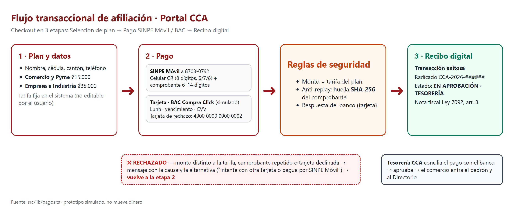
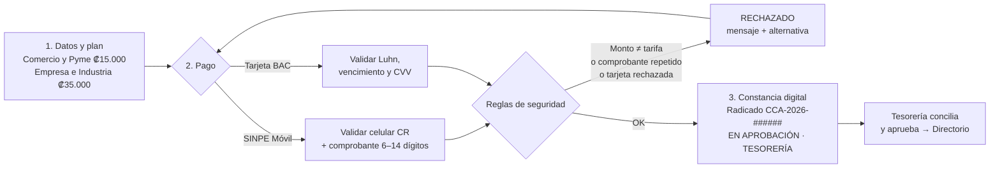
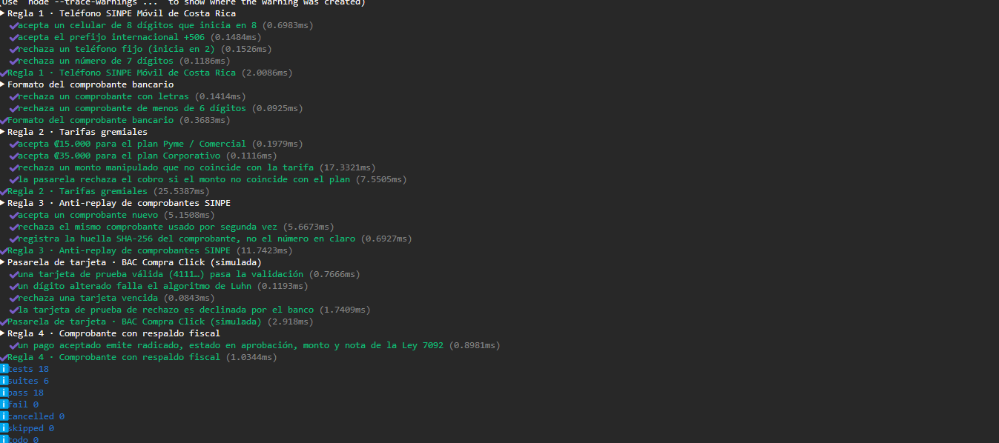
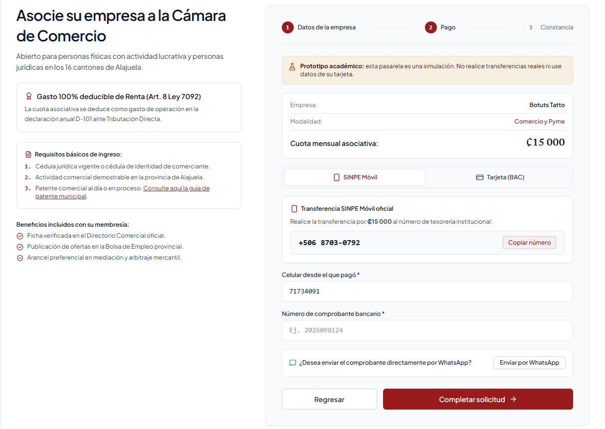
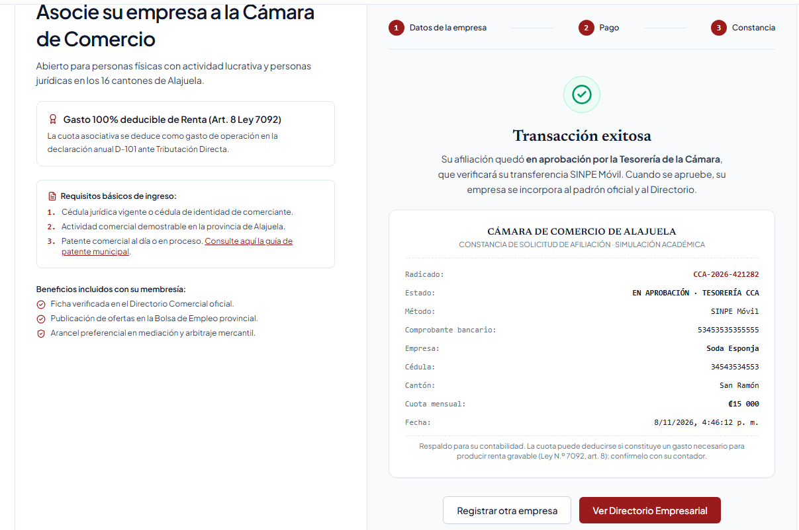

# 13. Arquitectura Transaccional y Pasarela Financiera (SINPE Móvil + BAC Compra Click)

> **Alcance.** La pasarela del portal es un **prototipo académico simulado**: valida los datos con reglas de negocio costarricenses y emite una constancia, pero **no mueve dinero** ni se conecta a un banco. Toda la lógica está en `src/lib/pagos.ts` y la verifica la suite `tests/pagos.test.ts` (18 pruebas). El portal publicado para pruebas es https://cca-alajuela-portal.vercel.app/afiliarse.

## 13.1 Diagnóstico de la brecha transaccional en la CCA

Hoy la afiliación a la Cámara no se puede completar en línea. El proceso es manual y en tres tiempos:

1. El comerciante hace una transferencia por IBAN o SINPE desde su banca en línea.
2. Envía el comprobante por correo o WhatsApp.
3. Espera a que el personal de Tesorería verifique el depósito en el estado de cuenta y lo dé de alta.

Esta arquitectura tiene tres fallas de diseño de información:

| Falla | Efecto en el usuario |
|---|---|
| **No hay un punto de cierre en el sitio.** La página explica cómo afiliarse pero no permite hacerlo. | El trámite se rompe en canales distintos (banco → correo → espera) y el prospecto abandona entre un paso y otro. |
| **No hay validación del dato.** El comprobante llega como texto libre o foto. | Errores de digitación y comprobantes reenviados solo se detectan cuando Tesorería concilia. |
| **No hay constancia inmediata.** El afiliado no recibe nada hasta que alguien revisa. | Personas como *Lic. Mariana* (que necesita respaldo para contabilidad) no tienen documento que archivar. |

Los *buyer personas* del proyecto marcan los dos requisitos de la solución: **Esteban** paga todo por SINPE Móvil y espera hacerlo en pocos pasos desde el celular; **Lic. Mariana** necesita un comprobante con datos fiscales para su contabilidad.

## 13.2 Arquitectura del motor SINPE Móvil y BAC Compra Click

El checkout se integró como un asistente (*wizard*) de **tres etapas** en `/afiliarse`. El estado avanza solo hacia adelante y cada etapa valida sus datos antes de permitir la siguiente.

*Figura 13.0.* Flujo transaccional de afiliación.




**Etapa 1 · Selección de plan y datos.** Nombre, cédula, cantón y teléfono del comercio, y el plan. Las tarifas son fijas en el código (`TARIFAS`): ₡15.000 *Comercio y Pyme* y ₡35.000 *Empresa e Industria*.

**Etapa 2 · Pago (pasarela híbrida).** Dos pestañas:

* **SINPE Móvil (método por defecto).** El portal muestra el número de Tesorería **8703-0792**, un botón para copiarlo y el enlace de WhatsApp de la Cámara. El usuario hace la transferencia desde su banco y digita el teléfono de origen y el número de comprobante.
* **Tarjeta · BAC Compra Click (simulado).** Número, nombre, vencimiento y CVV. Como en las pasarelas reales, existen **tarjetas de prueba**: cualquier tarjeta con formato válido se aprueba, excepto la **4000 0000 0000 0002**, que el "banco" rechaza por fondos insuficientes para poder probar el camino de error.

**Etapa 3 · Recibo digital.** La constancia se emite al instante con radicado, estado, método, referencia (comprobante o últimos 4 dígitos + autorización), empresa, cédula, cantón, monto, fecha y nota fiscal (Figura 13.3). El estado es **"EN APROBACIÓN · TESORERÍA CCA"**: el sistema le da al usuario un cierre inmediato, pero la incorporación al padrón queda sujeta a que Tesorería concilie el pago.

**Decisión de diseño: por qué "en aprobación" y no "aprobado".** SINPE Móvil no ofrece a comercios pequeños una API pública para consultar en línea si una transferencia entró. Sin esa consulta, un sistema que diga "aprobado" estaría aceptando cualquier número de comprobante. La arquitectura separa entonces dos momentos: la **validación inmediata del dato** (formato, monto, duplicados) en el portal y la **verificación del dinero** en la conciliación de Tesorería, que ahora recibe solicitudes estructuradas en lugar de correos con capturas.

## 13.3 Mecanismos de seguridad y prevención de fraude

Las cuatro reglas de negocio del enunciado se implementaron en `src/lib/pagos.ts`:

| Regla | Implementación | Qué evita |
|---|---|---|
| **1. Teléfono de Costa Rica** | `validarSinpe`: elimina el prefijo +506 y exige 8 dígitos que inicien en 6, 7 u 8 (`/^[678]\d{7}$/`) | Teléfonos fijos o incompletos que no pueden tener SINPE Móvil |
| **2. Tarifas gremiales exactas** | `validarMonto(plan, monto)`: el monto debe ser **idéntico** a `TARIFAS[plan]` | Montos manipulados en el navegador (p. ej. pagar ₡1.500 por un plan de ₡15.000) |
| **3. Anti-replay** | `huellaComprobante`: SHA-256 de `SINPE:<comprobante>`; si la huella ya está registrada, el pago se rechaza | Reutilizar un comprobante viejo para otra afiliación |
| **4. Comprobante con respaldo fiscal** | Todo pago aceptado devuelve radicado, estado, monto y `NOTA_FISCAL` | Afiliaciones sin documento para contabilidad |

Además, la tarjeta se valida con el **algoritmo de Luhn** (detecta un dígito mal digitado o dos dígitos transpuestos), con el vencimiento (la tarjeta vence al terminar el mes indicado) y con un CVV de 3 o 4 dígitos.

**Blindaje anti-replay con hash.** El sistema no guarda el número de comprobante en claro. Guarda su **huella criptográfica SHA-256** (Web Crypto, `crypto.subtle.digest`). Cuando llega un comprobante:

1. Se calcula su huella.
2. Si la huella ya existe en el registro, se rechaza: *"El comprobante … ya fue registrado para otra afiliación. No se permiten comprobantes duplicados."*
3. Si no existe, se registra y el pago continúa.

SHA-256 es determinista (el mismo comprobante produce siempre la misma huella, lo que permite detectar repeticiones) y de una sola vía (con la huella no se reconstruye el comprobante). **Limitación del prototipo:** el registro vive en el navegador (`localStorage` + memoria), por lo que solo detecta duplicados en el mismo dispositivo. En producción el registro debe estar en la base de datos de Tesorería con una restricción `UNIQUE` sobre la huella, para que el bloqueo sea global.

## 13.4 Fundamento jurídico y deducibilidad fiscal (Ley 7092)

El enunciado pide citar el artículo 8 de la Ley del Impuesto sobre la Renta (Ley N.º 7092) como norma que autoriza deducir "el 100 % de la cuota gremial". Se revisó el **texto consolidado oficial** de la ley y **esa afirmación no es exacta**:

* El artículo 8 establece como regla general que son deducibles de la renta bruta los costos y gastos **útiles, necesarios y pertinentes** para producir la renta gravable.
* El **inciso i)** se refiere a **"las cuotas patronales que se establezcan en las leyes"** (cargas sociales), no a cuotas de cámaras.
* **Ningún inciso menciona expresamente** las cuotas a cámaras empresariales ni un porcentaje de deducción.

Por lo tanto, la cuota de afiliación **puede** deducirse cuando el contribuyente demuestre que es un gasto necesario para su actividad (por ejemplo, por los servicios que recibe de la Cámara), pero no es automáticamente "100 % deducible". El recibo del portal se redactó con ese criterio:

> *"Respaldo para su contabilidad. La cuota puede deducirse si constituye un gasto necesario para producir renta gravable (Ley N.º 7092, art. 8); confírmelo con su contador."*

Con esto se cumple el objetivo de arquitectura de información (Lic. Mariana recibe al instante un documento con los datos que su contabilidad necesita) sin prometer un beneficio tributario que la ley no otorga de forma expresa. **Recomendación al equipo:** la página `/afiliarse` todavía muestra el texto *"Gasto 100% deducible de Renta (Art. 8 Ley 7092)"*, que debe corregirse con este mismo criterio.

## 13.5 Certificación de viabilidad con 18 pruebas unitarias

La suite usa el ejecutor nativo de Node.js (`node:test`), sin dependencias adicionales, y se ejecuta con:

```
npm test
```

#### Tabla 13.1. *Casos de prueba de la pasarela*

| # | Suite | Caso | Resultado |
|---|---|---|---|
| 1 | Regla 1 · Teléfono SINPE | Acepta un celular de 8 dígitos que inicia en 8 | ✔ |
| 2 | Regla 1 | Acepta el prefijo internacional +506 | ✔ |
| 3 | Regla 1 | Rechaza un teléfono fijo (inicia en 2) | ✔ |
| 4 | Regla 1 | Rechaza un número de 7 dígitos | ✔ |
| 5 | Formato del comprobante | Rechaza un comprobante con letras | ✔ |
| 6 | Formato del comprobante | Rechaza un comprobante de menos de 6 dígitos | ✔ |
| 7 | Regla 2 · Tarifas | Acepta ₡15.000 para el plan Pyme / Comercial | ✔ |
| 8 | Regla 2 | Acepta ₡35.000 para el plan Corporativo | ✔ |
| 9 | Regla 2 | Rechaza un monto manipulado que no coincide con la tarifa | ✔ |
| 10 | Regla 2 | La pasarela rechaza el cobro si el monto no coincide con el plan | ✔ |
| 11 | Regla 3 · Anti-replay | Acepta un comprobante nuevo | ✔ |
| 12 | Regla 3 | Rechaza el mismo comprobante usado por segunda vez | ✔ |
| 13 | Regla 3 | Registra la huella SHA-256, no el número en claro | ✔ |
| 14 | Tarjeta BAC (simulada) | Una tarjeta de prueba válida (4111…) pasa la validación | ✔ |
| 15 | Tarjeta BAC | Un dígito alterado falla el algoritmo de Luhn | ✔ |
| 16 | Tarjeta BAC | Rechaza una tarjeta vencida | ✔ |
| 17 | Tarjeta BAC | La tarjeta de prueba de rechazo es declinada por el banco | ✔ |
| 18 | Regla 4 · Respaldo fiscal | Un pago aceptado emite radicado, estado en aprobación, monto y nota de la Ley 7092 | ✔ |

**Resultado:** 18 pruebas, 6 suites, **18 aprobadas, 0 fallidas**, 186 ms (Node v24.17.0, 8/11/2026). Salida completa en `tools/10_ecommerce_pagos/resultados_npm_test.txt`.

*Figura 13.1.* Ejecución de `npm test` con las 18 pruebas aprobadas.


*Figura 13.2.* Etapa de pago con SINPE Móvil en el portal.


*Figura 13.3.* Constancia digital emitida por el prototipo.


**Validación con usuarios.** Además de las pruebas unitarias, la Misión 2 de la prueba de usabilidad (Cap. 8) evaluó este flujo con 5 personas: **5/5** completaron la afiliación y obtuvieron un radicado, con una facilidad promedio de **6.4/7**, y **4 de 4** de quienes recibieron el rechazo de la tarjeta de prueba se recuperaron cambiando de tarjeta sin ayuda.

#### Tabla 13.2. *Impacto: antes vs. después*

| Variable | Sitio actual | Portal propuesto | Evidencia |
|---|---|---|---|
| Cierre del trámite en línea | No existe | Afiliación + pago + constancia en un solo flujo | 5/5 usuarios lo completaron (Cap. 8) |
| Confirmación al usuario | Días, por correo | Constancia con radicado al instante (≈1,2 s de respuesta simulada) | Figura 13.3 |
| Aprobación final del pago | Manual por Tesorería | Sigue siendo manual, pero con datos ya validados y estructurados | Estado "En aprobación" |
| Comprobantes duplicados | Sin control | Bloqueados por huella SHA-256 (en el mismo dispositivo en el prototipo) | Pruebas 11–13 |
| Montos manipulados | Sin control | Rechazados si no coinciden con la tarifa | Pruebas 9–10 |
| Medios de pago | Transferencia manual | SINPE Móvil + tarjeta (BAC simulado) | Figura 13.2 |

**Limitaciones y trabajo futuro.**

1. La validación es de **formato y reglas**, no de fondos: confirmar que el dinero entró requiere la API del banco o la conciliación de Tesorería.
2. La integración real con BAC Compra Click requiere contrato de comercio, credenciales y un *webhook* de confirmación en el servidor.
3. El registro anti-replay debe moverse al servidor.
4. La constancia no sustituye la factura electrónica de Hacienda, que Tesorería debe emitir al aprobar.

## 13.6 Referencias

* Asamblea Legislativa de la República de Costa Rica. (1988). *Ley N.º 7092, Ley del Impuesto sobre la Renta* (texto consolidado). Sistema Costarricense de Información Jurídica. https://www.pgrweb.go.cr/scij/
* Banco Central de Costa Rica. (s. f.). *SINPE Móvil*. https://www.bccr.fi.cr/sistema-de-pagos/
* Luhn, H. P. (1960). *Computer for verifying numbers* (Patente de EE. UU. N.º 2.950.048). U.S. Patent Office.
* National Institute of Standards and Technology. (2015). *Secure Hash Standard (SHS)* (FIPS PUB 180-4). https://doi.org/10.6028/NIST.FIPS.180-4
* Node.js. (2025). *Test runner (node:test)*. https://nodejs.org/api/test.html
