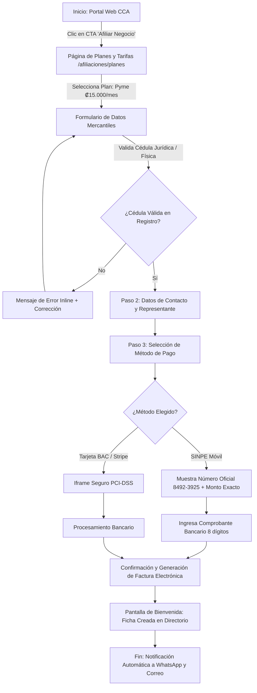
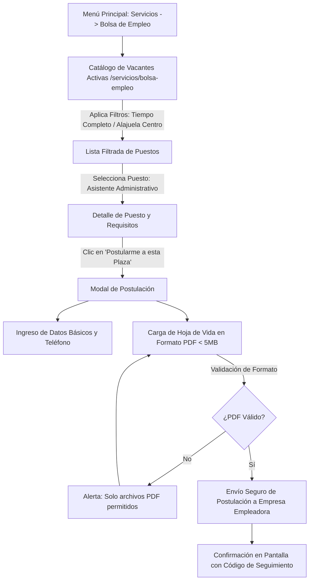

# Flujos de Usuario Reales (User Flows) - Cámara de Comercio de Alajuela (CCA)

Este documento contiene la lógica formal de navegación, toma de decisiones y puntos de contacto diagramados para su implementación en la herramienta **FlowMapp (User Flow Tool)**.

---

## Flujo 1: Afiliación Digital y Pasarela de Pago (Comerciante)



---

## Flujo 2: Búsqueda y Filtrado en Directorio de Comercios (Turista / Residente)

```mermaid
graph TD
    A[Inicio: Barra de Búsqueda Predictiva Algolia] -->|Escribe 'ferreteria coyol'| B[Dropdown Autocomplete con 3 Sugerencias]
    B -->|Presiona Enter o Selecciona 'Ver todos los 8 resultados'| C[Página de Resultados /directorio/busqueda]
    C --> D[Filtros Facetados Laterales: Cantón, Sector, Descuento CCA]
    D -->|Activa Checkbox 'Afiliado Verificado'| E[Refresco Instantáneo de Grid (<50ms)]
    E -->|Clic en Tarjeta de Comercio| F[Ficha Detallada del Comercio /directorio/comercio/slug]
    F --> G{Acción del Usuario}
    G -- Contactar --> H[Abre WhatsApp con Mensaje Prellenado]
    G -- Ubicación --> I[Abre Google Maps con Coordenadas Exactas]
    G -- Beneficio --> J[Muestra Cupón o Convenio Activo]
```

---

## Flujo 3: Postulación a Vacante en Bolsa de Empleo (Ciudadano Alajuelense)


